# PRD — Employee Demographic Dashboard (Agriaku & BBB)
> **Version:** 1.0.0 | **Status:** 🟡 Draft | **Last Updated:** 2026-10-11  
> **Author:** [TBD] | **Reviewer:** [TBD] | **Stakeholder:** [TBD]

---

## Table of Contents
1. [Overview](#1-overview)
2. [Goals & Success Metrics](#2-goals--success-metrics)
3. [Requirements](#3-requirements)
4. [Core Features](#4-core-features)
5. [User Roles & Permissions](#5-user-roles--permissions)
6. [User Flow](#6-user-flow)
7. [Screen & UI Breakdown](#7-screen--ui-breakdown)
8. [Architecture](#8-architecture)
9. [Database Schema](#9-database-schema)
10. [API Endpoints](#10-api-endpoints)
11. [Design & Technical Constraints](#11-design--technical-constraints)
12. [Out of Scope](#12-out-of-scope)
13. [Risks & Mitigations](#13-risks--mitigations)
14. [Timeline & Milestones](#14-timeline--milestones)
15. [Open Questions](#15-open-questions)

---

## 1. Overview

### Basis Dokumen & Konvensi

PRD ini disusun melalui **reverse-engineering** dari artefak berikut. Semua perilaku yang dideskripsikan adalah perilaku **as-built** kecuali ditandai sebagai usulan.

| Artefak | Isi | Dipakai untuk |
|---------|-----|---------------|
| Google Apps Script (v5 FIXED) | `doGet`, `getData`, `parseRow`, `parseDate`, `normalizeGender`, `buildSummary`, konstanta `COL` | Data layer, aturan status, mapping kolom |
| Frontend `WebApp Demographic` (HTML/CSS/Vanilla JS) | Filter, 3 tab, modal, export CSV | Fitur, kalkulasi, UI |
| `001 - SSOT - Database Karyawan ADI & BBB (Talenta API).xlsx` | Sheet `Guideline`, `Improvement Note`, `Database Karyawan (ADI & BBB)`, sheet master dan pivot | Sumber data, aturan bisnis status, snapshot data |

| Label | Arti |
|-------|------|
| ✅ **As-Built** | Terverifikasi dari kode |
| 🆕 **Usulan** | Rekomendasi PM, belum ada di kode |
| ⚠️ **Temuan** | Perilaku as-built yang berisiko atau tidak konsisten (detail di §13) |

> **Catatan integritas artefak:** salinan HTML yang diunggah kehilangan karakter `$` pada beberapa template literal (mis. `exOpenModal(...)`, `renderTopList`). Handler tersebut diasumsikan berfungsi sebagaimana maksud kodenya (lihat Q-11).

### Problem Statement

Data karyawan dua entitas (PT. Agriaku Digital Indonesia / ADI dan PT. Benih Berkah Berseri / BBB) ditarik dari Talenta API ke satu spreadsheet SSOT. Analisis demografi dan pergerakan karyawan (komposisi, new joiner, resign, turnover) sebelumnya bergantung pada pivot manual per individu di dalam workbook yang sama (sheet `Pivot - *`). Akibatnya: angka bisa berbeda antar pembuat pivot, setiap pertanyaan lintas dimensi menuntut pivot baru, dan HR/TA/manajemen tidak punya satu tampilan baku yang bisa difilter sendiri. Tanpa dashboard ini, keputusan headcount dan retensi bergantung pada rekap manual yang lambat dan sulit diaudit.

### Solution Summary

Web app berbasis Google Apps Script yang membaca langsung sheet `Database Karyawan (ADI & BBB)` (SSOT), menormalisasi datanya, lalu menyajikan tiga tab: **Overview** (KPI dan 11 chart demografi), **Employee Attrition** (new joiner vs resign, Turnover Rate, Retention Rate) dan **Data Explorer** (pivot lintas dimensi sampai 3 level). Semua angka dapat di-drill-down ke data karyawan per segmen dan di-export ke CSV.

### Target Users

> Persona diturunkan dari fitur dan struktur data (kolom MMR Finance, FA Journey Level, Join/Resign Date). Konfirmasi di Q-06.

| Persona | Deskripsi | Kebutuhan Utama |
|---------|-----------|-----------------|
| **HR Operations / HRIS Admin** | Pemilik SSOT dan script; menjaga kualitas master data | Memverifikasi data hasil sync Talenta, mendeteksi anomali (Unknown, dummy, tanggal), memvalidasi angka dashboard vs sheet |
| **HR Business Partner / HR Analytics** | Menganalisis komposisi dan pergerakan karyawan per Company, Dept, Sub-Dept | Filter cascading, TOR dan Retention per periode, alasan resign, cross-tab demografi |
| **Talent Acquisition** | Merencanakan rekrutmen dari pola join dan resign | New joiner per periode, TOR per posisi, headcount aktif per Sub-Dept/Branch/Job Level |
| **C-Level / Management** | Memantau ringkasan headcount dan risiko attrition | KPI sekilas, tren new joiner vs resign, segmentasi per Legal Entity dan Company |
| **Finance / Workforce Planning** *(asumsi)* | Mencocokkan headcount dengan perencanaan manpower | Distribusi per MMR Finance, Branch, Job Level |

---

## 2. Goals & Success Metrics

### Business Goals
- [ ] Menyediakan **satu tampilan baku** headcount aktif dan demografi karyawan ADI & BBB yang bersumber dari SSOT yang sama, menggantikan pivot manual per individu.
- [ ] Memberikan visibilitas **pergerakan karyawan** (new joiner vs resign) beserta TOR dan Retention Rate per periode, Company dan Posisi, berdasarkan **Resign Date** yang akurat.
- [ ] Memungkinkan **analisis mandiri lintas dimensi** (sampai 3 level) tanpa membuat pivot baru.
- [ ] Memastikan angka dashboard **dapat direkonsiliasi** dengan SSOT dan dapat diaudit (aturan status dan perhitungan terdokumentasi).
- [ ] Menjaga **perlindungan data pribadi** karyawan pada drill-down dan export.

### Key Performance Indicators (KPIs)

> Target bersifat usulan PM dan perlu persetujuan stakeholder (Q-12). Baseline "Belum diukur" berarti belum ada pengukuran di artefak.

| Metrik | Baseline Saat Ini | Target | Cara Mengukur |
|--------|-------------------|--------|---------------|
| Akurasi Total Resign (Attrition) vs sheet | Sebelum fix v5: tidak terhitung karena `resignDate` tidak dikirim ke frontend. Setelah fix: belum direkonsiliasi | Selisih 0 untuk 3 periode uji | Hitung `COUNTIFS` pada kolom Resign Date di sheet SSOT vs angka KPI Total Resign untuk rentang sama |
| Akurasi headcount aktif vs sheet | Belum diukur. Snapshot SSOT: 256 aktif non-dummy | Selisih 0 (di luar dummy) | Bandingkan KPI Karyawan Aktif vs `Active HC` pada sheet `Master Position` |
| Record dummy yang lolos ke dashboard | 35 dari 47 record ber-Job Level "Dummy" tidak tersaring (snapshot SSOT) | 0 | Hitung record dummy pada payload `getData` setelah filter |
| Waktu muat awal dashboard | Belum diukur | < 5 detik (p95, ±5.000 baris) | Ukur dari `loadData()` sampai render selesai |
| Kesegaran data yang ditampilkan | Sync harian: Talenta 00:00–01:00, gabungan 01:00–02:00 (sheet Guideline) | Dashboard menampilkan waktu sync sumber, selisih maksimal 24 jam | Bandingkan label "Last updated" dengan waktu sync sheet |
| Pengguna aktif mingguan | Belum diukur | [TBD] | Jumlah pengguna unik per minggu (butuh logging, lihat FR-20) |

---

## 3. Requirements

### Functional Requirements

> FR-01 s.d. FR-16 adalah **as-built** (✅). FR-17 s.d. FR-20 adalah **usulan** (🆕).

| ID | Kategori | Persyaratan | Prioritas |
|----|----------|-------------|-----------|
| FR-01 | Data Ingestion (F-01) | Sistem membaca seluruh baris sheet `Database Karyawan (ADI & BBB)` via `SpreadsheetApp`, melewati baris yang seluruh selnya kosong, dan menampilkan error terstruktur bila sheet tidak ada atau data kosong | 🔴 Must Have |
| FR-02 | Data Ingestion (F-01) | Sistem mem-parse **Join Date, Resign Date, Birth Date** dari tipe `Date`, serial number, atau string, dan mengeluarkan Join/Resign Date sebagai `YYYY-MM-DD` | 🔴 Must Have |
| FR-03 | Data Ingestion (F-01) | Sistem menurunkan `isActive` dari kolom **Status (A)** dengan aturan di §9.2; fallback berdasarkan Full Name dan Resign Date kosong | 🔴 Must Have |
| FR-04 | Data Ingestion (F-01) | Sistem menormalisasi Gender menjadi `Laki-laki`/`Perempuan`, mengisi `Unknown` untuk dimensi kosong, dan menghitung `age`, `ageGroup`, `los`, `losGroup` | 🔴 Must Have |
| FR-05 | Global Filter (F-02) | Filter Company, Legal Entity, Department, Sub-Dept, Position, dan Status (Aktif Saja / Aktif & Resign / Resign Saja) berlaku pada Overview, Explorer, dan (kecuali Status) Attrition | 🔴 Must Have |
| FR-06 | Global Filter (F-02) | Opsi Sub-Dept dan Position menyempit mengikuti Department yang dipilih; opsi Position menyempit mengikuti Sub-Dept | 🔴 Must Have |
| FR-07 | Global Filter (F-02) | Filter periode berdasarkan **Join Date**: Semua, Per Tahun, Per Bulan, Custom Range | 🔴 Must Have |
| FR-08 | Global Filter (F-02) | Record dummy (Department/Sub-Dept = "dummy" atau Status Employee dummy) dikeluarkan dari semua tampilan dan opsi filter | 🔴 Must Have |
| FR-09 | Overview (F-03) | Menampilkan 5 KPI card: Total Karyawan, Karyawan Aktif, Rata-rata Usia, Rata-rata LoS, Total Sub-Dept; setiap card dapat diklik untuk detail | 🔴 Must Have |
| FR-10 | Overview (F-03) | Menampilkan 11 chart demografi, 2 ranked list (Top Department, Top Branch), dan chart Resign Reason bersyarat | 🔴 Must Have |
| FR-11 | Attrition (F-04) | Menampilkan 4 KPI: Total New Joiner, Total Resign, Turn Over Rate, Retention Rate | 🔴 Must Have |
| FR-12 | Attrition (F-04) | Menampilkan chart New Joiner dan Resign per periode (stacked per Company), tren gabungan, dan tabel TOR per Posisi (Top 15); granularitas Tahun/Bulan; rentang berbasis Resign Date | 🔴 Must Have |
| FR-13 | Data Explorer (F-05) | Cross-tab hierarkis 1 sampai 3 dimensi dengan persentase terhadap total dan terhadap induk, plus chart dinamis | 🔴 Must Have |
| FR-14 | Modal (F-06) | Klik pada KPI/chart/baris membuka modal daftar karyawan dengan pencarian | 🔴 Must Have |
| FR-15 | Export (F-06) | Modal dapat mengekspor daftar ke CSV | 🔴 Must Have |
| FR-16 | Refresh (F-07) | Tombol Refresh memuat ulang data; loading state dan error state ditampilkan | 🟠 Should Have |
| FR-17 | Governance (F-08) | 🆕 Akses dibatasi ke akun/domain terotorisasi; endpoint JSON dan export tidak boleh terbuka bagi non-pengguna; atribut sensitif dapat dimasking | 🟠 Should Have |
| FR-18 | Attrition (F-09) | 🆕 TOR dihitung dari rata-rata headcount awal dan akhir periode; Retention didefinisikan terpisah dari TOR | 🟠 Should Have |
| FR-19 | Status (F-10) | 🆕 Status **On Notice** dikenali dan ditampilkan sebagai kategori sendiri | 🟠 Should Have |
| FR-20 | Observability (F-11) | 🆕 Menampilkan waktu sync sumber, caching payload, dan logging pemakaian | 🟡 Nice to Have |

**Prioritas:**
- 🔴 **Must Have** — Wajib ada di MVP, sistem tidak bisa berjalan tanpanya
- 🟠 **Should Have** — Penting namun bisa ditunda ke iterasi berikutnya
- 🟡 **Nice to Have** — Meningkatkan pengalaman namun bukan prioritas utama

### Non-Functional Requirements

| Kategori | Persyaratan | Target |
|----------|-------------|--------|
| **Performa** | Muat awal (panggilan `getData` + render) | < 5 detik p95 untuk ±5.000 baris; re-render saat filter < 1 detik |
| **Aksesibilitas** | Platform yang didukung | Web browser modern (Chrome/Edge) desktop; layout responsif pada breakpoint 1100px dan 768px sudah ada |
| **Keamanan** | Autentikasi dan otorisasi | Akun Google sesuai pengaturan deployment (as-built); target: dibatasi domain perusahaan + role |
| **Skalabilitas** | Volume data | Saat ini 4.180 record valid (5.053 baris termasuk 873 baris kosong); target ≥ 10.000 record tanpa perubahan arsitektur |
| **Ketersediaan** | Uptime | Mengikuti Google Workspace/Apps Script; target layanan 99% jam kerja |
| **Akurasi Data** | Konsistensi angka | 100% cocok dengan hasil hitung langsung dari SSOT pada rekonsiliasi periodik |
| **Kesegaran Data** | Latensi dari sumber | ≤ 24 jam (sync Talenta harian) |
| **Privasi** | Data pribadi karyawan | Tidak ada kolom NIK, rekening bank, alamat, kontak pada payload (as-built terpenuhi); nama dan atribut demografis individual hanya untuk pengguna berwenang |

---

## 4. Core Features

### Feature List

| ID | Fitur | Deskripsi Singkat | Prioritas | Status |
|----|-------|-------------------|-----------|--------|
| F-01 | Data Ingestion & Normalisasi | Apps Script `getData` membaca SSOT, parsing tanggal, derivasi status, usia, LoS, normalisasi | 🔴 Must Have | ✅ Selesai |
| F-02 | Global Filters | Company, Entity, Dept, Sub-Dept, Position, Status, periode Join Date | 🔴 Must Have | ✅ Selesai |
| F-03 | Overview Tab | 5 KPI card dan 11 chart demografi | 🔴 Must Have | ✅ Selesai |
| F-04 | Employee Attrition Tab | New Joiner vs Resign, TOR, Retention berbasis Resign Date | 🔴 Must Have | ✅ Selesai |
| F-05 | Data Explorer Tab | Pivot lintas dimensi 3 level + chart dinamis | 🔴 Must Have | ✅ Selesai |
| F-06 | Modal Drill-Down & Export CSV | Raw data per segmen dan unduh CSV | 🔴 Must Have | ✅ Selesai |
| F-07 | Refresh & State Handling | Reload data, loading, dan pesan error | 🟠 Should Have | ✅ Selesai |
| F-08 | Kontrol Akses & Proteksi Data Pribadi | Batasi akses, amankan endpoint JSON, kebijakan export | 🟠 Should Have | 🔲 Belum Mulai |
| F-09 | Metrik Attrition Terstandar | TOR dan Retention berbasis HC awal/akhir periode | 🟠 Should Have | 🔲 Belum Mulai |
| F-10 | Status On Notice | Kategori status On Notice dari Offboarding Form | 🟠 Should Have | 🔵 In Progress (Improvement Note #1) |
| F-11 | Freshness, Caching & Usage Log | Waktu sync sumber, CacheService, logging pemakaian | 🟡 Nice to Have | 🔲 Belum Mulai |

**Status Legend:** 🔲 Belum Mulai | 🔵 In Progress | ✅ Selesai | ❌ Dibatalkan

---

### F-01: Data Ingestion & Normalisasi
> Backend Apps Script yang mengubah baris spreadsheet menjadi payload JSON bersih untuk frontend. Hanya kolom yang dibutuhkan dashboard yang dikirim; kolom PII (NIK, alamat, kontak, email, rekening) tidak ikut.

**User Story:**
> Sebagai `HR Operations`, saya ingin `dashboard membaca langsung SSOT dengan aturan parsing yang konsisten`, agar saya bisa `memastikan angka dashboard selalu sama dengan data sumber`.

**Acceptance Criteria:**
- [ ] `getData()` membaca sheet bernama persis `Database Karyawan (ADI & BBB)` (konstanta `SHEET_NAME`) dan mengembalikan `employees[]`, `summary`, `totalRows`, `lastUpdated`, `debug`.
- [ ] **Resign Date (kolom L, index 11)** diparse oleh `parseDate()` dan dikirim sebagai `resignDate` (`YYYY-MM-DD`); bila tidak bisa diparse, nilai string mentah dikirim; bila kosong, string kosong.
- [ ] `parseDate()` menangani: objek `Date`, angka (serial, epoch 25569), string yang dapat diparse `Date`, dan pola `dd/mm/yyyy`, `dd-mm-yyyy`, `dd.mm.yyyy`.
- [ ] `isActive` mengikuti aturan §9.2 dan konsisten antara `employees[].isActive` dan `summary.active/resigned`.
- [ ] Gender dinormalisasi: `f|wanita|perempuan|female` → `Perempuan`; `m|laki|pria|male` → `Laki-laki`.
- [ ] Age group: `< 25`, `25–30`, `31–35`, `36–40`, `41–45`, `> 45`. LoS group: `< 1 tahun`, `1–3 tahun`, `3–5 tahun`, `5–10 tahun`, `> 10 tahun`.
- [ ] Employee ID memakai kolom D; bila kosong memakai User ID (kolom B).

**Edge Cases & Error Handling:**
- Jika sheet tidak ditemukan → sistem harus mengembalikan `{ error }` berisi daftar nama sheet yang tersedia.
- Jika baris data < 2 → sistem harus mengembalikan `{ error: "Data kosong." }`.
- Jika terjadi exception → sistem harus mengembalikan `{ error, stack }` dan frontend menampilkannya di error box.
- Jika Resign Date berisi teks tak dikenal → sistem harus mengirim teks mentah dan frontend memperlakukannya sebagai tanggal tidak valid (tidak masuk periode resign).
- Jika Birth Date kosong → `age = null`, `ageGroup = "Unknown"`, record dikecualikan dari rata-rata usia.
- Jika kolom A berisi nilai di luar daftar `INACTIVE_STATUS`/`ACTIVE_STATUS` (mis. "On Notice") → sistem harus memakai fallback: aktif bila Full Name terisi dan Resign Date kosong.
- ⚠️ Jika zona waktu script bukan UTC → `toISOString()` dapat menggeser tanggal satu hari (lihat R-01).

---

### F-02: Global Filters
> Satu bar filter yang berlaku lintas tab.

**User Story:**
> Sebagai `HR Business Partner`, saya ingin `memfilter berdasarkan Company, Entity, Department, Sub-Dept, Position, Status dan periode`, agar saya bisa `fokus pada segmen yang saya analisis`.

**Acceptance Criteria:**
- [ ] Filter Company, Legal Entity, Department, Sub-Dept, Position, Status berfungsi sebagai AND.
- [ ] Opsi dropdown dibangun dari data **non-dummy**, diurutkan alfabetis.
- [ ] Memilih Department menyempitkan opsi Sub-Dept dan Position; memilih Sub-Dept menyempitkan opsi Position.
- [ ] Status default **Aktif Saja**; opsi lain: Aktif & Resign, Resign Saja.
- [ ] Periode Join Date: Semua / Per Tahun (dropdown tahun, urut menurun) / Per Bulan (`input month`) / Custom Range (dari–sampai, inklusif); badge periode aktif dan tombol Reset muncul saat periode dipakai.
- [ ] Ringkasan "Filter aktif: …" tampil di sub-header.
- [ ] Mengubah filter me-render ulang tab yang sedang aktif.

**Edge Cases & Error Handling:**
- Jika kombinasi filter menghasilkan 0 record → sistem harus menampilkan KPI 0 dan chart kosong tanpa error.
- Jika record tidak punya Join Date dan filter periode aktif → record harus dikeluarkan.
- Jika nilai terpilih tidak ada lagi di opsi hasil penyempitan → pilihan harus kembali ke "Semua".
- ⚠️ Company dan Legal Entity **tidak** ikut cascading; keduanya filter independen. Persyaratan "cascading" hanya berlaku Department → Sub-Dept → Position.
- ⚠️ Tab Attrition mengabaikan filter Status dan filter periode Join Date; hanya filter organisasi yang dipakai.

---

### F-03: Overview Tab
> Ringkasan headcount dan komposisi demografi.

**User Story:**
> Sebagai `C-Level / Management`, saya ingin `melihat KPI dan komposisi karyawan sekilas`, agar saya bisa `memahami kondisi headcount tanpa membuka data mentah`.

**Acceptance Criteria:**
- [ ] **5 KPI card**: (1) Total Karyawan = jumlah record setelah filter; (2) Karyawan Aktif; (3) Rata-rata Usia (aktif, 1 desimal); (4) Rata-rata LoS tahun (aktif); (5) Total Sub-Dept = jumlah sub-dept unik pada karyawan aktif. Subteks card 1 dan 2 mengikuti filter Status.
- [ ] **11 chart canvas (Chart.js)**:

| # | Chart | Tipe | Basis data |
|---|-------|------|------------|
| 1 | Gender | Doughnut | Aktif |
| 2 | Status Karyawan (Tipe Kontrak) | Doughnut | Aktif, kolom Status Employee (M) |
| 3 | Agama | Doughnut | Aktif |
| 4 | Age Group | Bar vertikal (urut tetap) | Aktif |
| 5 | Job Level | Bar horizontal, Top 12 | Aktif |
| 6 | Length of Service | Bar vertikal (urut tetap) | Aktif |
| 7 | Sub-Department | Bar horizontal, Top 15 | Aktif |
| 8 | Status Pernikahan | Doughnut | Aktif |
| 9 | MMR Finance | Bar horizontal, Top 12 | Aktif |
| 10 | Legal Entity | Doughnut | Semua record hasil filter (aktif + resign sesuai filter Status) |
| 11 | FA Journey Level | Bar horizontal, Top 10 | Aktif |

- [ ] **2 ranked list**: Top Department (10) dan Top Branch (10), dengan bar proporsional, jumlah, dan persen; dapat diklik.
- [ ] **Resign Reason** (bar horizontal Top 8) muncul hanya bila ada record resign pada hasil filter.
- [ ] Doughnut menampilkan label persen via `chartjs-plugin-datalabels` untuk irisan > 4%; bar menampilkan `jumlah (persen%)`.
- [ ] Klik KPI atau elemen chart membuka modal (F-06) berisi karyawan terkait; KPI Usia dan LoS mengurutkan modal (tertua / terlama dulu).

**Edge Cases & Error Handling:**
- Jika tidak ada karyawan aktif → KPI rata-rata menampilkan 0.0 dan chart kosong.
- Jika dimensi bernilai kosong → dikelompokkan ke `Unknown` (snapshot: 581 record tanpa Sub-Dept; 3.779 tanpa FA Journey Level) dan **dihitung sebagai satu grup**, termasuk pada KPI Total Sub-Dept.
- Jika filter Status = Aktif Saja → chart Resign Reason tidak dirender.
- Jika Join Date tidak valid → LoS = "—" dan `losGroup = Unknown`.

---

### F-04: Employee Attrition Tab
> Analisis pergerakan karyawan berbasis **Join Date** (new joiner) dan **Resign Date** (resign).

**User Story:**
> Sebagai `HR Business Partner`, saya ingin `membandingkan new joiner dengan resign serta melihat TOR dan Retention per periode`, agar saya bisa `mengidentifikasi periode dan posisi dengan attrition tinggi`.

**Acceptance Criteria:**
- [ ] Kontrol: granularitas **Per Tahun / Per Bulan**; rentang tanggal `attFrom` s.d. `attTo` (kosong = semua periode); tombol Reset; peringatan "Filter periode ini menggunakan Resign Date".
- [ ] Basis data: seluruh record non-dummy yang lolos filter organisasi (Company, Entity, Dept, Sub-Dept, Position), **tanpa** filter Status dan periode Join Date global.
- [ ] **New Joiner** = record dengan Join Date di dalam rentang (bila rentang kosong: semua record).
- [ ] **Resign** = record dengan `isActive = false` **dan** Resign Date valid di dalam rentang.
- [ ] 4 KPI card:

| KPI | Rumus as-built | Subteks |
|-----|----------------|---------|
| Total New Joiner | `COUNT(joiners)` | `N periode` |
| Total Resign | `COUNT(resignedInPeriod)` | `dari N total karyawan` |
| Turn Over Rate | `resign / avgHC × 100`, `avgHC = max(1, round((aktifSaatIni + resign) / 2))` | `% (resign / avg headcount)` |
| Retention Rate | `(avgHC − resign) / avgHC × 100` | `% (karyawan yg tetap aktif)` |

- [ ] Chart: (a) New Joiner per periode, stacked per Company; (b) Resign per periode, stacked per Company; (c) Tren Gabungan line chart New Joiner vs Resign; (d) tabel **TOR per Posisi Top 15** (kolom Posisi, Resign periode, Total HC, TOR %, bar proporsi), diurutkan TOR menurun, hanya posisi dengan resign > 0.
- [ ] Klik card New Joiner/Resign, segmen chart (periode × company), atau baris TOR membuka modal.

**Edge Cases & Error Handling:**
- Jika tidak ada resign pada rentang → tabel TOR menampilkan "Tidak ada data resign pada periode ini."
- Jika Resign Date kosong atau tidak valid → record tidak dihitung sebagai resign pada periode.
- Jika `avgHC` < 1 → dipaksa 1 untuk mencegah pembagian nol.
- Jika karyawan berstatus Aktif tetapi Resign Date di masa depan (snapshot: 1 record, 2026-10-25) → tidak dihitung resign sampai Last Day lewat (konsisten dengan Guideline status).
- ⚠️ Rentang tanggal yang sama dipakai untuk **Join Date** (new joiner) dan **Resign Date** (resign), meski label hanya menyebut Resign Date.
- ⚠️ TOR as-built memakai headcount aktif **saat ini**, bukan headcount awal/akhir periode; Retention = 100 − TOR; TOR per posisi memakai **total record historis** posisi sebagai penyebut (lihat R-02 dan F-09).
- ⚠️ LoS pada modal untuk karyawan resign dihitung sampai **hari ini**, bukan sampai Resign Date.

---

### F-05: Data Explorer Tab
> Tool pivot lintas dimensi sampai 3 level dengan chart yang menyesuaikan.

**User Story:**
> Sebagai `HR Analytics`, saya ingin `memilih sampai tiga dimensi dan langsung melihat tabel dan chart`, agar saya bisa `menjawab pertanyaan ad-hoc tanpa membuat pivot manual`.

**Acceptance Criteria:**
- [ ] Dimensi 1 (wajib, 15 opsi): Department, Sub-Department, Gender, Age Group, Length of Service, Job Level, Grade, Contract Type, Agama, Status Pernikahan, MMR Finance, Branch, Legal Entity, Company, FA Journey Level.
- [ ] Dimensi 2 (opsional, 12 opsi): Gender, Age Group, LoS, Job Level, Grade, Contract Type, Sub-Department, Department, Agama, Status Pernikahan, MMR Finance, Branch.
- [ ] Dimensi 3 (opsional, 9 opsi): Gender, Age Group, LoS, Job Level, Grade, Contract Type, Agama, Status Pernikahan, Position.
- [ ] Hasil berupa tabel hierarkis (level 1 tebal, level 2 dan 3 menjorok) dengan kolom Jumlah, % Total, dan bar proporsi; level 2 dan 3 menampilkan persen terhadap induk; urut jumlah menurun.
- [ ] Header hasil menampilkan jalur dimensi, total karyawan aktif, dan jumlah grup utama.
- [ ] **Chart dinamis**: 1 dimensi → bar distribusi dengan label `jumlah (persen%)` (horizontal bila > 8 grup, maksimum 20 grup); ≥ 2 dimensi → bar Dimensi 1 × Dimensi 2 dengan mode **Stacked / Grouped / 100%** (horizontal bila > 6 grup). Dimensi 3 hanya tampil di tabel.
- [ ] Klik baris tabel atau segmen chart membuka modal untuk irisan terkait.
- [ ] Explorer otomatis jalan saat tab dibuka dan saat filter global berubah.

**Edge Cases & Error Handling:**
- Jika tidak ada karyawan aktif pada filter → tampilkan "Tidak ada data aktif pada filter ini." dan sembunyikan chart.
- Jika filter Status = Resign Saja → Explorer tetap hanya memakai karyawan aktif sehingga kosong (⚠️ perilaku as-built; lihat Q-15).
- Jika dimensi bernilai kosong → grup `Unknown`.
- Jika Dimensi 2/3 sama dengan Dimensi 1 → sistem menghasilkan hierarki tidak informatif (belum ada validasi; usulan: cegah pilihan duplikat).

---

### F-06: Modal Drill-Down & Export CSV
> Detail karyawan per segmen dan unduhan data.

**User Story:**
> Sebagai `HR Business Partner`, saya ingin `melihat dan mengunduh daftar karyawan di balik angka`, agar saya bisa `memverifikasi dan menindaklanjuti data`.

**Acceptance Criteria:**
- [ ] Modal menampilkan judul, subjudul (jumlah), kolom pencarian, tabel, dan footer "Menampilkan N karyawan".
- [ ] Kolom: Nama, Department, Sub-Dept, Posisi, Job Level, Gender, Usia, LoS (thn), Join Date, Resign Date, Branch, Status (badge Aktif/Resign).
- [ ] Pencarian memfilter berdasarkan nama, department, sub-dept, posisi, branch.
- [ ] Modal tertutup via tombol ✕, klik overlay, atau tombol `Esc`.
- [ ] Tombol **Export CSV** mengunduh berkas ber-BOM UTF-8 dengan 18 kolom: Nama, Department, Sub Dept, Posisi, Job Level, Gender, Usia, LoS (thn), Join Date, Resign Date, Status, Branch, Legal Entity, Agama, Status Pernikahan, MMR Finance, Contract Type, FA Journey Level. Nama berkas: `export_<judul modal>.csv`.

**Edge Cases & Error Handling:**
- Jika hasil pencarian kosong → tabel kosong dan footer "Menampilkan 0 karyawan".
- Jika nilai sel kosong → modal menampilkan `-`.
- ⚠️ Export hanya menyaring berdasarkan **nama dan department**, sedangkan pencarian modal mencakup 5 kolom → hasil export bisa berbeda dari yang terlihat.
- ⚠️ Escape tanda kutip di CSV memakai `\"` bukan `""` → kolom dapat rusak di Excel bila nilai mengandung kutip.
- ⚠️ Modal merender nilai sel via `innerHTML` tanpa `esc()` → risiko injeksi HTML dari data sumber.
- Jika modal dibuka dari chart non-aktif → daftar mengikuti segmen yang diklik, bukan seluruh data.

---

### F-07: Refresh & State Handling
> Memuat data, menampilkan loading dan error.

**User Story:**
> Sebagai `pengguna dashboard`, saya ingin `memuat ulang data dan mendapat pesan jelas saat gagal`, agar saya bisa `mengetahui apakah masalahnya akses, data, atau script`.

**Acceptance Criteria:**
- [ ] Data otomatis dimuat saat halaman dibuka; tombol **↻ Refresh Data** memuat ulang dan dinonaktifkan selama loading.
- [ ] Header menampilkan "Last updated: <waktu> · N baris total".
- [ ] LoS dihitung ulang di browser dari Join Date setiap load (`losLive`, `losDisplay`, `losGroup`).
- [ ] Opsi filter dibangun ulang setelah data masuk.

**Edge Cases & Error Handling:**
- Jika halaman dibuka sebagai file HTML biasa (bukan Web App) → tampilkan petunjuk membuka URL deployment.
- Jika `getData` mengembalikan kosong → "Apps Script tidak mengembalikan data."
- Jika `data.error` → tampilkan pesan dan stack.
- Jika `employees` bukan array → "Format data tidak valid".
- Jika pemanggilan gagal (`withFailureHandler`) → tampilkan pesan error dan aktifkan kembali tombol.
- ⚠️ "Last updated" adalah waktu eksekusi script, **bukan** waktu sync data sumber.

---

### F-08: Kontrol Akses & Proteksi Data Pribadi 🆕
> Dashboard memuat nama, usia, agama, dan status pernikahan individual, serta endpoint JSON `?data=1`. Akses perlu dikunci dan diaudit.

**User Story:**
> Sebagai `HRIS Admin`, saya ingin `membatasi siapa yang dapat melihat dan mengekspor data individual`, agar saya bisa `memenuhi kewajiban perlindungan data pribadi dan kontrol akses`.

**Acceptance Criteria:**
- [ ] Deployment dibatasi ke domain/akun terotorisasi; mode akses terdokumentasi.
- [ ] Endpoint `?data=1` dilindungi (token/role) atau dinonaktifkan di produksi.
- [ ] Role minimal: Viewer Agregat (tanpa nama), Viewer Detail, Admin.
- [ ] Export CSV hanya untuk role berwenang dan tercatat (siapa, kapan, segmen).
- [ ] `XFrameOptionsMode.ALLOWALL` ditinjau; embed hanya ke domain yang diizinkan.

**Edge Cases & Error Handling:**
- Jika pengguna tanpa role detail membuka modal → sistem harus menampilkan agregat tanpa kolom nama.
- Jika pengguna tidak terdaftar mengakses `?data=1` → sistem harus menolak (HTTP 403 atau pesan error terstruktur).

---

### F-09: Metrik Attrition Terstandar 🆕
> Menyelaraskan TOR dan Retention dengan praktik pelaporan human capital (selaras ISO 30414: turnover = jumlah leaver ÷ rata-rata headcount periode).

**User Story:**
> Sebagai `C-Level / Management`, saya ingin `TOR dan Retention yang dihitung dengan definisi baku`, agar saya bisa `membandingkan antar periode dan antar entitas dengan adil`.

**Acceptance Criteria:**
- [ ] `HC(D)` = jumlah record non-dummy dengan `Join Date ≤ D` dan (`Resign Date` kosong atau `> D`).
- [ ] `TOR = leaver_periode ÷ ((HC(awal) + HC(akhir)) ÷ 2) × 100`.
- [ ] Retention didefinisikan terpisah: `(HC(awal) − leaver dari kohort HC(awal)) ÷ HC(awal) × 100`.
- [ ] TOR per Posisi memakai headcount rata-rata posisi pada periode yang sama.
- [ ] Footnote rumus tampil di UI; hasil lama dan baru dapat dibandingkan saat UAT.
- [ ] Opsi annualized TOR untuk rentang bukan 12 bulan.

**Edge Cases & Error Handling:**
- Jika `HC(awal) = 0` → tampilkan "n/a", bukan 0%.
- Jika Resign Date < Join Date → baris ditandai anomali dan dikeluarkan dari perhitungan dengan peringatan.
- Jika rentang menjangkau masa depan → HC(akhir) dipotong di hari ini.

---

### F-10: Status On Notice 🆕
> Sheet `Guideline` mendefinisikan 3 status (Active / Inactive / On Notice), dan sheet master memiliki kolom `On Notice HC`, tetapi script belum mengenali On Notice.

**User Story:**
> Sebagai `Talent Acquisition`, saya ingin `melihat karyawan yang sudah mengajukan resign tetapi belum Last Day`, agar saya bisa `menyiapkan backfill lebih awal`.

**Acceptance Criteria:**
- [ ] `"on notice"` dikenali eksplisit pada `parseRow` (bukan lewat fallback) dan dikirim sebagai `statusGroup = "On Notice"`.
- [ ] Filter Status bertambah opsi On Notice; KPI Aktif tetap mencakup On Notice sesuai definisi Guideline (Q-15).
- [ ] Attrition menampilkan "Resign terjadwal" terpisah dari resign terealisasi.
- [ ] Sumber Offboarding Form baru terintegrasi (Improvement Note #1 In Progress).

**Edge Cases & Error Handling:**
- Jika Employee ID ada di Offboarding Form dan Resign Date terisi → aturan Resign Date menang (sesuai Guideline langkah 1–2).
- Jika Offboarding Form tidak terbaca saat sync → status tetap dari sync terakhir dan tampil peringatan.

---

### F-11: Freshness, Caching & Usage Log 🆕

| Item | Deskripsi |
|------|-----------|
| Waktu sync sumber | Tampilkan kolom `Updated At` / waktu sync Database Karyawan, bukan waktu eksekusi script |
| Caching | `CacheService` (TTL singkat) untuk payload agar tidak membaca seluruh sheet setiap kali |
| Usage log | Catat pengguna, waktu, tab, dan export (mendukung KPI adopsi dan audit) |

---

## 5. User Roles & Permissions

> **As-built tidak ada RBAC**: setiap akun yang lolos pengaturan akses deployment melihat semua fitur, termasuk nama karyawan dan export. Matriks di bawah menunjukkan kondisi as-built; kolom terakhir adalah target usulan F-08.

```
┌─────────────────────────────────────────────────────────────┐
│                    ROLE HIERARCHY                            │
│                                                             │
│  👑 HRIS Admin (Owner Spreadsheet & Script)                 │
│     └── Kelola SSOT, script, deployment, akses              │
│                                                             │
│  👤 Pengguna Dashboard (HR / TA / C-Level)                  │
│     └── Lihat semua tab, filter, drill-down, export (as-built)│
│                                                             │
│  👁️  Viewer Agregat (🆕 Usulan)                             │
│     └── Hanya angka agregat, tanpa nama dan export          │
└─────────────────────────────────────────────────────────────┘
```

| Fitur / Aksi | HRIS Admin | Pengguna Dashboard (as-built) | Viewer Agregat (🆕) |
|---|:---:|:---:|:---:|
| Membuka Web App (sesuai izin deployment) | ✅ | ✅ | ✅ |
| Gunakan Global Filter | ✅ | ✅ | ✅ |
| Lihat Overview, Attrition, Explorer | ✅ | ✅ | ✅ |
| Refresh Data | ✅ | ✅ | ✅ |
| Drill-down modal (nama individual) | ✅ | ✅ | ❌ |
| Export CSV | ✅ | ✅ | ❌ |
| Akses endpoint JSON `?data=1` | ✅ | ✅ | ❌ |
| Edit data SSOT / sheet sumber | ✅ | ❌ | ❌ |
| Ubah script / re-deploy | ✅ | ❌ | ❌ |
| Kelola akses deployment | ✅ | ❌ | ❌ |

---

## 6. User Flow

### 6.1 High-Level User Journey

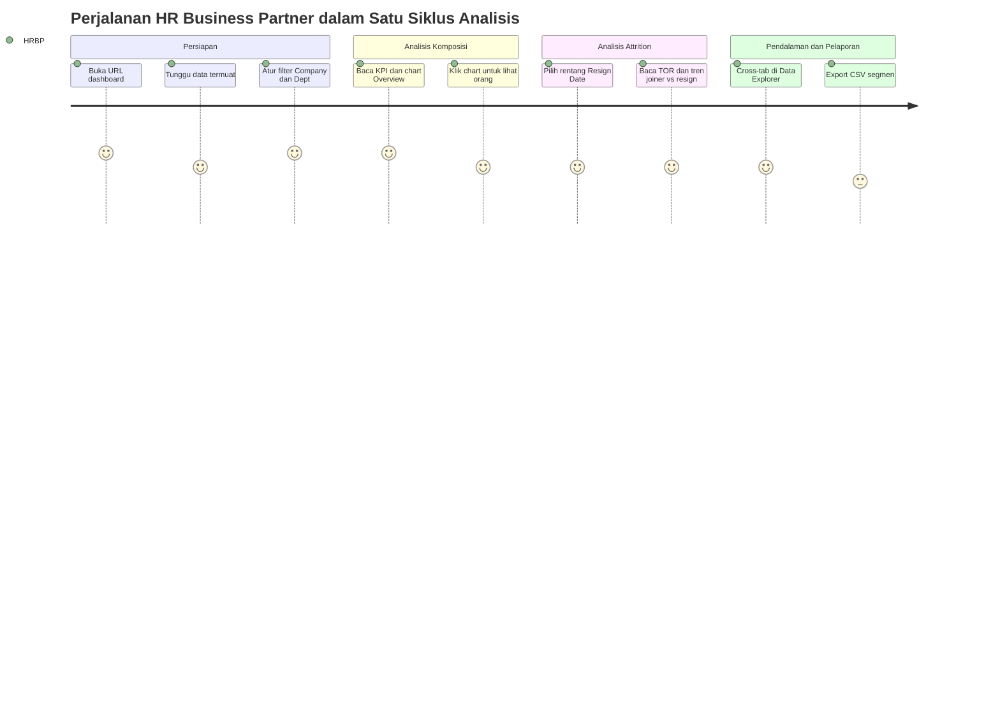

---

### 6.2 Authentication Flow

> Dashboard tidak memiliki login sendiri; autentikasi sepenuhnya oleh pengaturan deployment Google Apps Script (Q-01).

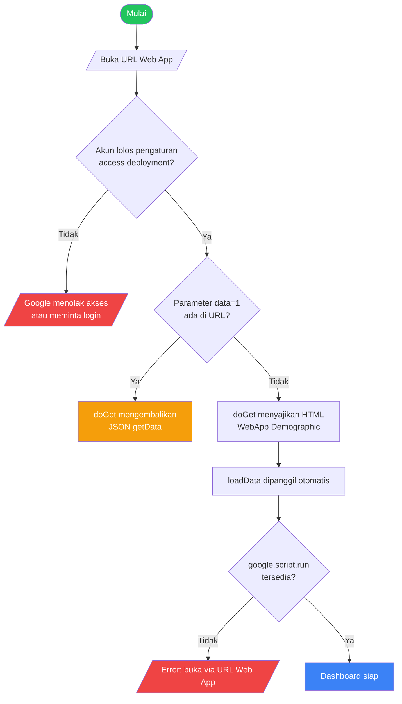

---

### 6.3 Main Application Flow

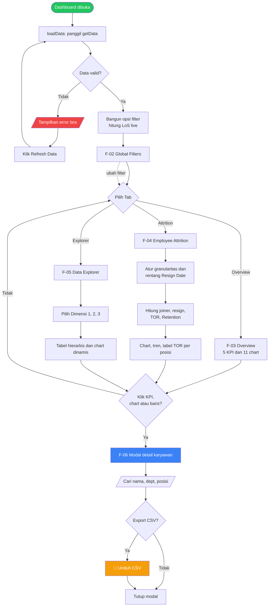

---

### 6.4 Critical Sub-Flow: Pemuatan & Normalisasi Data (F-01, F-07)

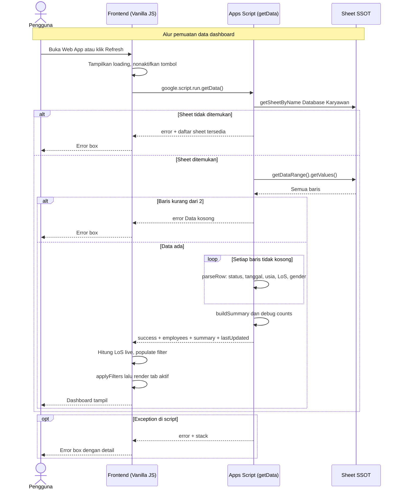

---

### 6.5 Critical Sub-Flow: Kalkulasi Attrition (F-04)

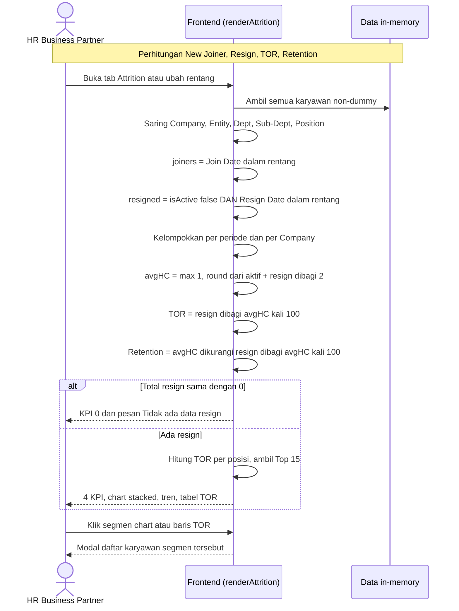

---

### 6.6 Critical Sub-Flow: Drill-Down & Export CSV (F-06)

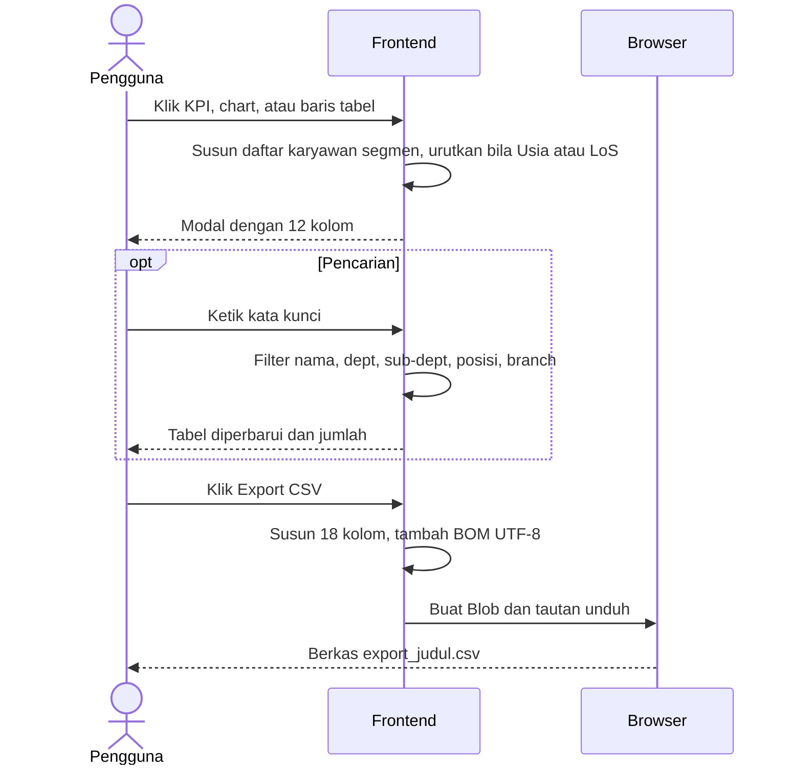

---

### 6.7 Critical Sub-Flow: Sinkronisasi SSOT dari Talenta (hulu data, per sheet `Guideline`)

> Proses ini berjalan di luar dashboard namun menentukan kualitas seluruh angka. Aturan jadwal dan status bersumber dari sheet `Guideline`.

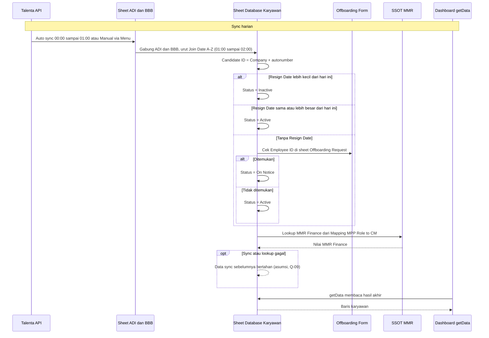

---

## 7. Screen & UI Breakdown

### Daftar Layar

> Aplikasi satu halaman; perpindahan tab dilakukan sisi klien tanpa perubahan URL.

| ID | Nama Layar | Rute / Path | Deskripsi Singkat |
|----|------------|-------------|-------------------|
| S-01 | Shell Dashboard | `<web-app-url>/exec` | Header, sub-header (ringkasan filter + Refresh), tab bar, filter bar, area KPI |
| S-02 | Tab Overview | Tab "📊 Overview" | 5 KPI card, 11 chart, 2 ranked list, Resign Reason bersyarat |
| S-03 | Tab Employee Attrition | Tab "📉 Employee Attrition" | Kontrol granularitas dan rentang, 4 KPI, chart New Joiner/Resign/Tren, tabel TOR per Posisi |
| S-04 | Tab Data Explorer | Tab "🔍 Data Explorer" | Kontrol 3 dimensi, chart dinamis, tabel hierarkis |
| S-05 | Modal Detail Data | Overlay | Daftar karyawan, pencarian, Export CSV |
| S-06 | State Loading / Error | Area konten | Spinner dan error box |
| S-07 | Endpoint Data JSON | `<web-app-url>/exec?data=1` | Keluaran JSON `getData` (bukan UI) |

### Wireframe / Layout Notes

**S-02: Tab Overview**
```
┌─────────────────────────────────────────────────────────────────┐
│ Agriaku & BBB — Employee Demographic Dashboard                  │
│ Last updated: <waktu> · N baris total                           │
├─────────────────────────────────────────────────────────────────┤
│ Filter aktif: ...                                [↻ Refresh Data]│
├─────────────────────────────────────────────────────────────────┤
│ [📊 Overview] [📉 Employee Attrition] [🔍 Data Explorer]        │
├─────────────────────────────────────────────────────────────────┤
│ Filter: [Company▼][Entity▼][Dept▼][Sub-Dept▼][Position▼][Status▼]│
│ Periode Join: (Semua)(Per Tahun)(Per Bulan)(Custom Range) [Reset]│
├─────────────────────────────────────────────────────────────────┤
│ ┌────────┐ ┌────────┐ ┌────────┐ ┌────────┐ ┌────────┐         │
│ │ Total  │ │ Aktif  │ │ Rata2  │ │ Rata2  │ │ Total  │         │
│ │Karyawan│ │        │ │ Usia   │ │  LoS   │ │Sub-Dept│         │
│ └────────┘ └────────┘ └────────┘ └────────┘ └────────┘         │
│                                                                 │
│ ┌─Gender──┐ ┌─Tipe Kontrak─┐ ┌─Agama──┐                        │
│ └─────────┘ └──────────────┘ └────────┘                        │
│ ┌─Age Group─┐ ┌─Top Department (ranked list)───┐               │
│ ┌─Job Level─┐ ┌─Length of Service─┐                             │
│ ┌─Sub-Dept Top 15─┐ ┌─Status Pernikahan─┐                      │
│ ┌─MMR Finance─┐ ┌─Legal Entity─┐                                │
│ ┌─Top Branch─┐ ┌─FA Journey Level─┐                             │
│ ┌─Resign Reason (hanya bila ada resign)─────┐                   │
└─────────────────────────────────────────────────────────────────┘
```

**S-03: Tab Employee Attrition**
```
┌─────────────────────────────────────────────────────────────────┐
│ Granularitas: (Per Tahun)(Per Bulan) │ Rentang Resign Date:     │
│ [dari] s/d [sampai] [✕ Reset]  ⚠️ Filter ini memakai Resign Date │
├─────────────────────────────────────────────────────────────────┤
│ ┌─New Joiner─┐ ┌──Resign──┐ ┌─Turn Over─┐ ┌─Retention─┐        │
│ └────────────┘ └──────────┘ └───────────┘ └───────────┘        │
│ ┌─New Joiner per Periode─┐ ┌─Resign per Periode─┐              │
│ ┌─Tren Gabungan: New Joiner vs Resign────────────┐              │
│ ┌─TOR per Posisi Top 15 (Posisi|Resign|HC|TOR%|bar)─┐          │
└─────────────────────────────────────────────────────────────────┘
```

---

## 8. Architecture

### System Architecture Overview

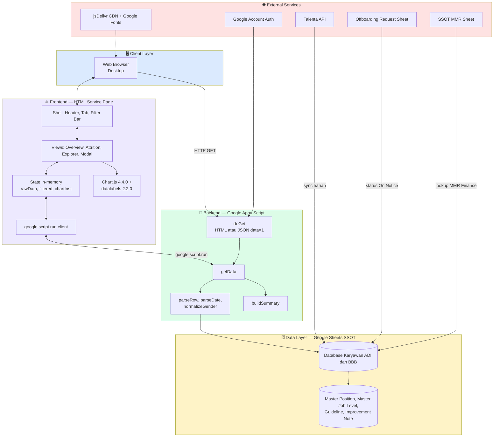

### Data Flow — Proses Utama

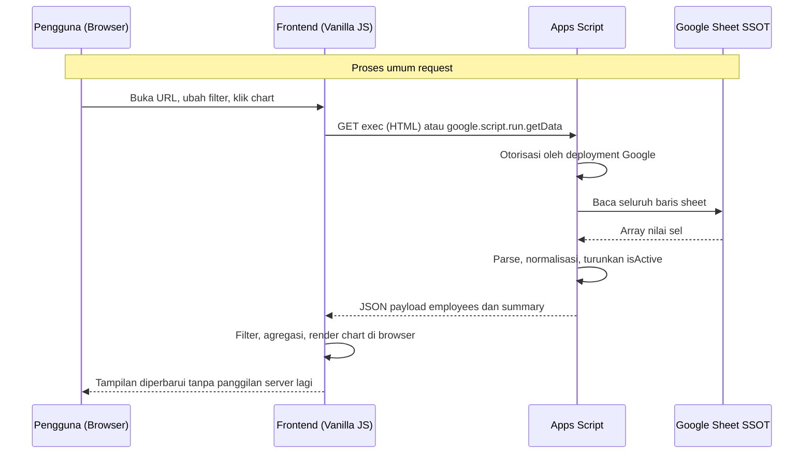

> Setelah payload dimuat, **seluruh filter, agregasi, dan chart dihitung di browser**; server hanya dipanggil saat load/Refresh.

---

## 9. Database Schema

> Tidak ada RDBMS. "Database" adalah Google Sheet yang menjadi SSOT. Model berikut adalah **model logis** dari sheet.

### 9.1 Data Source — Single Source of Truth

| Atribut | Nilai |
|---------|-------|
| Berkas SSOT | **`001 - SSOT - Database Karyawan ADI & BBB (Talenta API).xlsx`** (spreadsheet; script terikat ke spreadsheet via `getActiveSpreadsheet`) |
| Sheet yang dibaca dashboard | `Database Karyawan (ADI & BBB)` (konstanta `SHEET_NAME`) |
| Asal data | Talenta API → sheet `ADI` dan `BBB` → digabung ke `Database Karyawan (ADI & BBB)`, diurutkan Join Date A–Z |
| Jadwal sync | ADI dan BBB: harian 00:00–01:00; gabungan: harian 01:00–02:00; manual via menu |
| Sheet terkait (tidak dibaca dashboard) | `Guideline`, `Improvement Note`, `Master Job Level`, `Master Position`, `SSOT MMR`, dan sheet pivot/pendukung lain |
| Snapshot volume | 4.180 record valid (3.039 ADI, 1.141 BBB); 289 Active, 3.891 Inactive; 51 record dummy; 873 baris kosong di rentang sheet |

### 9.2 Aturan Status (sheet Guideline vs kode)

**Aturan sumber (`Guideline`) — kolom A `Status (Active/Inactive/On Notice)`:**
1. `Resign Date` (Last Day) < hari ini → **Inactive**
2. `Resign Date` ≥ hari ini → **Active**
3. Tanpa Resign Date dan Employee ID ada di Offboarding Form (sheet `Offboarding Request (ADI & BBB)`) → **On Notice**
4. Selain itu → **Active**

**Aturan di kode (`parseRow`) untuk `isActive`:**

| Urutan | Kondisi (pada kolom A, huruf kecil, `includes`) | Hasil |
|--------|------------------------------------------------|-------|
| 1 | Mengandung salah satu `INACTIVE_STATUS`: resign, resigned, inactive, terminated, non-active, nonactive, tidak aktif, off, keluar, dummy, dummy contract, dummy probation | `isActive = false` |
| 2 | Mengandung salah satu `ACTIVE_STATUS`: aktif, active, contract, permanent, freelance, internship, outsource, probation, pkwt, pkwtt | `isActive = true` |
| 3 | Fallback: Full Name terisi **dan** Resign Date kosong | `isActive = true`, selain itu `false` |

> ⚠️ Kolom **A (Status)** menentukan aktif/non-aktif. Kolom **M (Status Employee)** adalah **tipe kontrak** dan dikirim sebagai `status`/`contractType` ke frontend. Keduanya sering tertukar.  
> ⚠️ Pencocokan substring bersifat rapuh: nilai "On Notice" tidak cocok daftar mana pun (jatuh ke fallback), dan nilai yang mengandung "off" (mis. "Offboarding") akan menjadi non-aktif.

### 9.3 Mapping Kolom Penting (variabel `COL`)

| Index | Kolom | Header SSOT | Variabel `COL` | Payload frontend | Catatan |
|:---:|:---:|-------------|----------------|------------------|---------|
| 0 | A | Status | `status` | `isActive` (turunan) | **Status utama** Active/Inactive/(On Notice); tidak dikirim mentah |
| 1 | B | User ID | `userId` | `id` (fallback) | Dipakai bila Employee ID kosong |
| 3 | D | Employee ID | `employeeId` | `id` | |
| 4 | E | Full Name | `fullName` | `name` | Dipakai pada fallback status |
| 5 | F | Organization | `organization` | `department` | Dimensi Department; "dummy" disaring |
| 6 | G | Sub-Department | `subDepartment` | `subDept` | |
| 7 | H | Project | `project` | `project` | Dikirim, belum dipakai UI |
| 8 | I | Position | `position` | `position` | Filter, Explorer Dim 3, TOR per posisi |
| 9 | J | Job Level | `jobLevel` | `jobLevel` | |
| 10 | K | **Join Date** | `joinDate` | `joinDate` (`YYYY-MM-DD`) | Basis periode Join, New Joiner, LoS |
| 11 | L | **Resign Date** | `resignDate` | `resignDate` (`YYYY-MM-DD`) | Basis resign pada Attrition; diparse sejak fix v5 |
| 12 | M | Status Employee | `statusEmployee` | `status`, `contractType` | **Tipe kontrak**: Permanent, Contract, Outsource, Probation, Internship, Freelance, Dummy |
| 15 | P | Birth Date | `birthDate` | `age`, `ageGroup` | Tanggal lahir tidak dikirim; hanya usia turunan |
| 21 | V | Branch Name | `branchName` | `branch` | |
| 22 | W | MMR Location | `mmrLocation` | `location` | Dikirim, belum dipakai UI |
| 23 | X | Religion | `religion` | `religion` | |
| 24 | Y | Gender | `gender` | `gender` | Dinormalisasi |
| 25 | Z | Marital Status | `maritalStatus` | `maritalStatus` | |
| 27 | AB | Length Of Service | `lengthOfService` | `los` | Dipakai bila terisi; frontend menghitung ulang LoS dari Join Date |
| 31 | AF | Grade | `grade` | `grade` | |
| 33 | AH | MMR Finance | `mmrFinance` | `mmrFinance` | Hasil lookup dari SSOT MMR |
| 34 | AI | FA Journey Level | `faJourneyLevel` | `faJourneyLevel` | Banyak kosong (Unknown) |
| 35 | AJ | Legal Entity | `legalEntity` | `legalEntity` | |
| 36 | AK | Company | `company` | `company` | ADI atau BBB |
| 37 | AL | Resignation Reason | `resignReason` | `resignReason` | Chart Resign Reason |

**Terdefinisi di `COL` tetapi tidak dikirim ke frontend:** Candidate ID (C), End Date (N), Email (O), Birth Place (Q), Citizen ID Address (R), Residential Address (S), NIK (T), Mobile Phone (U), Blood Type (AA), Approval Line (AC), Manager Name (AD), Manager Email (AE), Profile Picture (AG), Resignation Reason Detail (AM).  
**Ada di sheet tetapi tidak ada di `COL`:** Bank Name, Account Number, Account Holder Name (AN–AP) — tidak dibaca script. Pertahankan kondisi ini (lihat §11 Security).

### Entity Relationship Diagram (ERD)

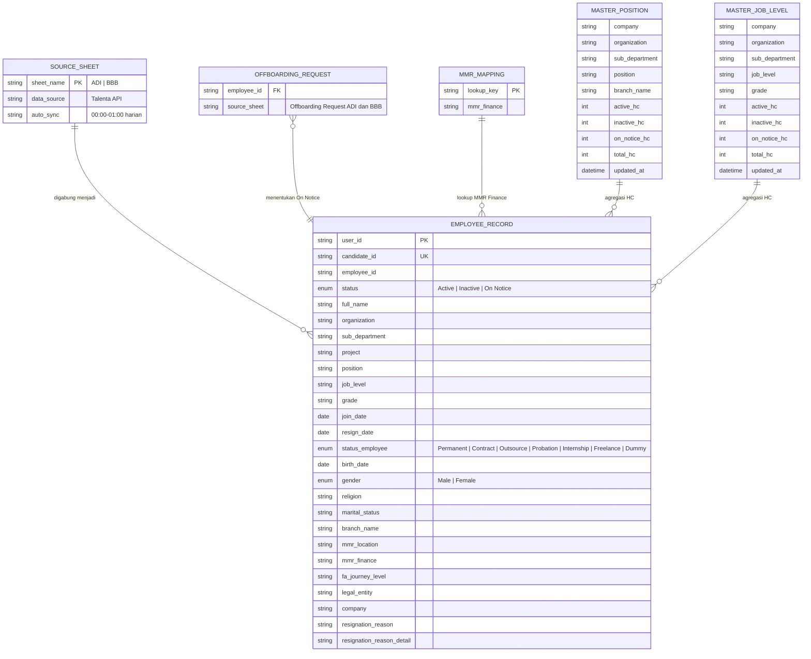

### Deskripsi Tabel

| Tabel (Sheet) | Deskripsi | Kolom Kunci |
|---------------|-----------|-------------|
| **SOURCE_SHEET** (`ADI`, `BBB`) | Sheet mentah hasil sync Talenta API per perusahaan | `sheet_name`, jadwal sync |
| **EMPLOYEE_RECORD** (`Database Karyawan (ADI & BBB)`) | SSOT gabungan; satu baris per karyawan/kontrak. Satu-satunya sheet yang dibaca dashboard | `user_id`, `candidate_id` (Company + autonumber), `employee_id`, `status`, `join_date`, `resign_date` |
| **OFFBOARDING_REQUEST** (`Offboarding Request (ADI & BBB)`, spreadsheet terpisah) | Daftar karyawan yang mengajukan offboarding; penentu On Notice. Kolom lain tidak diketahui (Q-09) | `employee_id` |
| **MMR_MAPPING** (`Mapping: MPP Role to CM` pada SSOT MMR) | Tabel lookup nilai MMR Finance. Kunci lookup diasumsikan (Q-09) | `lookup_key`, `mmr_finance` |
| **MASTER_POSITION** | Rollup headcount per Company/Org/Sub-Dept/Position/Branch (Active, Inactive, On Notice, Total) | `position`, `branch_name`, `updated_at` |
| **MASTER_JOB_LEVEL** | Rollup headcount per Company/Org/Sub-Dept/Job Level/Grade | `job_level`, `grade`, `updated_at` |

> Penurunan kolom `EMPLOYEE_RECORD` yang tidak ada di ERD (PII) ada di §9.3. Sheet pendukung lain (`Pivot *`, `PKWT *`, `Reporting Line Hierarchy`, `Sub-Dept PIC`, `Master Data - HR`, dan lain-lain) berada di luar lingkup dashboard.

### Indexing Strategy

N/A: tidak ada database relasional. Strategi performa setara:

```sql
-- Padanan logis (tidak dijalankan): kueri yang dilakukan dashboard di memori browser
-- 1. Filter organisasi:      WHERE company = ? AND legal_entity = ? AND organization = ? AND sub_department = ? AND position = ?
-- 2. Headcount aktif:        WHERE is_active = true
-- 3. Resign per periode:     WHERE is_active = false AND resign_date BETWEEN ? AND ?
-- 4. New joiner per periode: WHERE join_date BETWEEN ? AND ?
-- Rekomendasi: kolom Status, Join Date, Resign Date di sheet sumber selalu bertipe Date/teks baku;
-- hindari baris kosong di ujung sheet (getDataRange membaca 5.053 baris untuk 4.180 record).
```

---

## 10. API Endpoints

> Tidak ada REST API. Antarmuka sebenarnya adalah Web App Apps Script dan satu fungsi server yang dipanggil via `google.script.run`.

### Web App (`doGet`)
| Method | Endpoint | Deskripsi | Auth |
|--------|----------|-----------|------|
| `GET` | `<web-app-url>/exec` | Menyajikan halaman HTML `WebApp Demographic` (`XFrameOptionsMode.ALLOWALL`) | ⚠️ Sesuai pengaturan deployment (Q-01) |
| `GET` | `<web-app-url>/exec?data=1` | Mengembalikan JSON hasil `getData()` | ⚠️ Sesuai pengaturan deployment (Q-01) |

### Server Function (`google.script.run`)
| Method | Fungsi | Deskripsi | Auth |
|--------|--------|-----------|------|
| `RPC` | `getData()` | Membaca sheet SSOT dan mengembalikan payload karyawan + ringkasan | ✅ Sesi Google pengguna |

### Fungsi Internal (bukan endpoint)
| Fungsi | Peran |
|--------|-------|
| `parseRow(row)` | Normalisasi satu baris |
| `parseDate(raw)` | Parsing tanggal Date/serial/string/`dd-mm-yyyy` |
| `normalizeGender(raw)` | Normalisasi gender |
| `buildSummary(employees)` | Agregat `summary` (saat ini tidak dipakai frontend, yang menghitung ulang sendiri) |

### Contoh Request & Response

**`getData()` / `GET /exec?data=1`**
```json
// Response 200 OK (disingkat; nilai contoh disamarkan)
{
  "success": true,
  "lastUpdated": "2026-10-11T05:00:00.000Z",
  "totalRows": 4180,
  "debug": {
    "headerCheck": {
      "colA_status": "Status",
      "colM_statusEmp": "Status Employee",
      "colL_resignDate": "Resign Date",
      "colAH_mmrFinance": "MMR Finance"
    },
    "uniqueStatuses": ["Contract", "Outsource", "Permanent"],
    "uniqueContractTypes": ["Contract", "Outsource", "Permanent"],
    "activeCount": 289,
    "resignedCount": 3891
  },
  "summary": { "total": 4180, "active": 289, "resigned": 3891, "avgAge": 0, "avgLoS": 0 },
  "employees": [
    {
      "id": "EMP-0001",
      "name": "Nama Karyawan",
      "department": "COMMERCIAL",
      "subDept": "Agrochemical",
      "project": "Unknown",
      "position": "Posisi Contoh",
      "jobLevel": "(15a - F) Associate Manager OR Specialist - IC",
      "grade": "F",
      "gender": "Laki-laki",
      "religion": "Unknown",
      "maritalStatus": "Unknown",
      "age": 31,
      "ageGroup": "31–35",
      "los": "2.4",
      "losGroup": "1–3 tahun",
      "joinDate": "2024-05-01",
      "resignDate": "2026-10-25",
      "status": "Permanent",
      "contractType": "Permanent",
      "branch": "Pusat",
      "location": "Unknown",
      "mmrFinance": "Unknown",
      "legalEntity": "PT. Agriaku Digital Indonesia",
      "company": "PT. Agriaku Digital Indonesia",
      "resignReason": "",
      "faJourneyLevel": "Unknown",
      "isActive": true
    }
  ]
}

// Response error (sheet tidak ada)
{ "error": "Sheet \"Database Karyawan (ADI & BBB)\" tidak ada. Sheet tersedia: Guideline, ADI, BBB" }

// Response error (data kosong)
{ "error": "Data kosong." }

// Response error (exception)
{ "error": "<message>", "stack": "<stack trace>" }
```

> ⚠️ Envelope tidak konsisten: sukses memakai `success: true`, error hanya memakai `error` (tanpa `success: false` dan tanpa kode). Usulan v1.1: `{ success:false, error:{ code, message } }` dengan kode `SHEET_NOT_FOUND`, `EMPTY_DATA`, `INTERNAL_ERROR`, `FORBIDDEN`.  
> ⚠️ Respons error pada `?data=1` dan `stack` pada error box dapat membocorkan detail internal.

---

## 11. Design & Technical Constraints

### Technology Stack
| Layer | Pilihan Teknologi | Alasan |
|-------|-------------------|--------|
| **Frontend** | HTML + CSS + **Vanilla JavaScript** (satu berkas `WebApp Demographic`) | Tanpa build step, mudah dideploy dan dipelihara tim HR |
| **Visualisasi** | **Chart.js 4.4.0** + **chartjs-plugin-datalabels 2.2.0** (jsDelivr CDN) | Doughnut/bar/line ringan, label persen pada chart |
| **Backend** | **Google Apps Script Web App** (`HtmlService`, `ContentService`, `SpreadsheetApp`) | Terintegrasi langsung dengan SSOT Google Sheets; tanpa server sendiri |
| **Database** | **Google Sheets** SSOT (`Database Karyawan (ADI & BBB)`) | Sumber tunggal dari sync Talenta; dikelola HR |
| **ORM** | N/A | Pembacaan langsung `getDataRange().getValues()` |
| **Auth** | Google Account via pengaturan deployment Web App | Tanpa manajemen password sendiri |
| **Deployment** | Apps Script Deploy → Manage Deployments (URL `/exec`) | Distribusi satu URL; versi di-redeploy manual |

### Typography Rules
Konfigurasi font as-built (diambil dari kode frontend):

| Role | Font Stack |
|------|-----------|
| **Heading** | `'Syne', sans-serif` (bobot 400/600/700/800) |
| **Body** | `'DM Sans', sans-serif` (bobot 300/400/500) |
| **Mono** | N/A (tidak dipakai) |

Token warna as-built: `--accent1 #5BAD3A`, `--accent2 #F5A623`, `--accent3 #7DC052`, `--accent4 #E05A2B`, `--accent5 #3A8A5B`, `--bg #f2f6f0`, `--text #2C3E2D`, `--muted #7A8C7B`, `--radius 14px`; palet chart 15 warna hijau/oranye. Font dimuat dari Google Fonts. Konfirmasi bahwa konfigurasi ini baku (Q-12).

### Coding Standards
- **Bahasa:** JavaScript ES6+ (Apps Script V8), tanpa TypeScript saat ini
- **Struktur:** satu berkas HTML (CSS + JS inline) dan satu berkas `.gs`; usulan pemisahan modul bila fitur bertambah
- **Konvensi data:** semua dimensi kosong dikonversi ke `Unknown`; tanggal dikirim `YYYY-MM-DD`
- **Testing:** belum ada; usulan: uji rekonsiliasi angka vs sheet dan uji parsing tanggal/status (lihat F-09, F-10)
- **Versi:** tidak ada versioning berkas; usulan: tag versi pada komentar kepala berkas dan catat di Changelog
- **Escape output:** gunakan `esc()` untuk seluruh nilai yang dirender via `innerHTML`

### Security Constraints
- **As-built:** autentikasi oleh Google; `XFrameOptionsMode.ALLOWALL`; payload tidak memuat NIK, alamat, kontak, email, rekening bank (tetap dipertahankan).
- **Wajib (usulan F-08):** akses dibatasi ke domain/akun terotorisasi; endpoint `?data=1` dilindungi atau dinonaktifkan; role Viewer Agregat vs Viewer Detail; export tercatat (audit trail); error `stack` tidak ditampilkan ke pengguna akhir.
- **Perlindungan data pribadi:** nama, usia, agama, status pernikahan adalah data pribadi karyawan; perlakuan mengikuti UU No. 27 Tahun 2022 (PDP) dan kebijakan internal; kontrol akses selaras prinsip ISO/IEC 27001 (least privilege, logging).
- **Integritas data:** dashboard bersifat baca-saja; tidak ada penulisan ke SSOT.
- **Sanitasi:** semua nilai sel yang dirender via `innerHTML` harus di-escape; nilai CSV yang diawali `=`, `+`, `-`, `@` harus dinetralkan; kutip di CSV digandakan (`""`).
- **Transport:** HTTPS (disediakan Google).
- **Dependensi eksternal:** Chart.js, datalabels, dan Google Fonts dimuat dari CDN publik; usulan pin versi + SRI.

---

## 12. Out of Scope

Fitur-fitur berikut **tidak termasuk** dalam versi ini (as-built v5 dan roadmap v1.1):

| Fitur | Alasan Tidak Dimasukkan | Kemungkinan Versi |
|-------|-------------------------|-------------------|
| Penulisan/koreksi data kembali ke SSOT dari dashboard | Dashboard dirancang baca-saja demi integritas master data | Tidak direncanakan |
| Koneksi langsung ke Talenta API dari dashboard | Sync sudah ditangani di lapisan SSOT | v2.0 |
| Prediksi attrition / people analytics lanjutan | Butuh data historis lebih kaya dan model | v2.0 |
| Analisis kompensasi/gaji dan data finansial pribadi | Di luar lingkup demografi dan berisiko privasi | v3.0 |
| Aplikasi mobile native | Web responsif cukup untuk kebutuhan saat ini | v3.0 |
| Notifikasi otomatis (email/Slack) saat TOR melewati ambang | Perlu definisi ambang dan kanal | v2.0 |
| Snapshot historis headcount (time-series bulanan tersimpan) | Perlu penyimpanan terpisah; F-09 menghitung dari tanggal join/resign | v1.5 |
| Dashboard Reporting Line / Organization Chart | Data ada di SSOT tetapi bukan fokus demografi | v2.0 |

---

## 13. Risks & Mitigations

| ID | Risiko | Dampak | Kemungkinan | Mitigasi |
|----|--------|--------|-------------|----------|
| R-01 | **Pergeseran tanggal satu hari**: `parseDate` menghasilkan `Date` lalu `toISOString().split("T")[0]` mengonversi ke UTC. Pada zona waktu script UTC+7 (mis. Asia/Jakarta), tanggal 00:00 lokal menjadi hari sebelumnya, sehingga Join/Resign Date di awal bulan (mis. 1 Juli) dapat jatuh ke bulan sebelumnya pada agregasi per bulan | 🔴 Tinggi | 🟡 Sedang (tergantung zona waktu script, Q-02) | Format tanggal dengan `Utilities.formatDate(d, Session.getScriptTimeZone(), "yyyy-MM-dd")`; uji dengan tanggal awal/akhir bulan |
| R-02 | **TOR/Retention tidak baku**: penyebut = `(aktif saat ini + resign) / 2`, bukan rata-rata HC awal/akhir periode; Retention = 100 − TOR; TOR per posisi memakai total record historis. Angka dapat salah baca bagi manajemen | 🔴 Tinggi | 🔴 Tinggi | Implementasi F-09; tampilkan rumus di UI; validasi dengan HR Head (Q-03) |
| R-03 | **Paparan data pribadi**: akses bergantung pengaturan deployment, endpoint `?data=1`, `ALLOWALL` framing, modal nama individual, dan export tanpa audit | 🔴 Tinggi | 🟡 Sedang | F-08: batasi akses, role, audit log, nonaktifkan `?data=1` di produksi, tinjau framing |
| R-04 | **Record dummy lolos**: `isDummy` hanya memeriksa Organization/Sub-Dept/Status Employee; 35 dari 47 record ber-Job Level "Dummy" tidak tersaring, termasuk 1 record dengan Join Date 1900-01-02 | 🟠 Sedang | 🔴 Tinggi | Perluas aturan dummy (Job Level, Employee ID uji) atau tandai di SSOT dengan flag eksplisit (Q-05) |
| R-05 | **Mapping status rapuh**: `includes()` pada kolom A; "On Notice" jatuh ke fallback, nilai mengandung "off" jadi non-aktif; Resign Date masa depan tidak terlihat sebagai pergerakan | 🟠 Sedang | 🟡 Sedang | Pakai pencocokan sama-dengan dan pemetaan eksplisit; implementasi F-10 |
| R-06 | **Sumber data tidak segar/sync gagal**: "Last updated" adalah waktu eksekusi script, bukan waktu sync; kegagalan Talenta API atau Offboarding Form tidak terlihat | 🟠 Sedang | 🟡 Sedang | F-11: tampilkan waktu sync sumber; alert saat sync gagal |
| R-07 | **Ketidakkonsistenan KPI vs filter**: Attrition mengabaikan filter Status/Join; rentang tanggal sama dipakai untuk joiner dan resign; Explorer selalu aktif-only; LoS resign dihitung sampai hari ini | 🟠 Sedang | 🔴 Tinggi | Dokumentasikan di UI (tooltip); pisahkan rentang joiner/resign; hitung LoS resign sampai Resign Date |
| R-08 | **Bug export CSV**: filter export hanya nama+department, escape kutip salah, tanpa netralisasi formula | 🟠 Sedang | 🟡 Sedang | Perbaiki sesuai F-06 dan §11 |
| R-09 | **Kuota dan performa Apps Script**: membaca seluruh sheet tiap load tanpa cache; payload tumbuh bersama data; 873 baris kosong ikut terbaca | 🟠 Sedang | 🟢 Rendah | `CacheService`, pangkas baris kosong, pagination bila > 10.000 record |
| R-10 | **Distorsi KPI oleh Outsource**: 3.238 dari 4.180 record adalah Outsource sehingga TOR dan headcount didominasi churn outsource | 🟠 Sedang | 🔴 Tinggi | Tambah filter/segmentasi kontrak pada Attrition; konfirmasi definisi HC (Q-14) |
| R-11 | **Parsing tanggal string ambigu**: `new Date(s)` dicoba sebelum regex `dd/mm/yyyy`, sehingga "05/12/2025" terbaca 12 Mei bila sel berupa teks | 🟡 Rendah | 🟢 Rendah (sel sumber saat ini bertipe tanggal) | Cek pola `dd/mm/yyyy` sebelum `new Date` |
| R-12 | **Artefak sumber tidak otoritatif**: HTML yang diunggah kehilangan karakter `$` pada template literal | 🟡 Rendah | 🟡 Sedang | Minta berkas sumber asli sebelum implementasi (Q-11) |

---

## 14. Timeline & Milestones

> Dashboard sudah berjalan (as-built). Timeline berikut adalah **rencana hardening v1.1** dan seluruh tanggal bersifat usulan (Q-12). Satu-satunya tanggal historis yang tercatat: penambahan Resignation Reason selesai 2026-03-09 (`Improvement Note`).

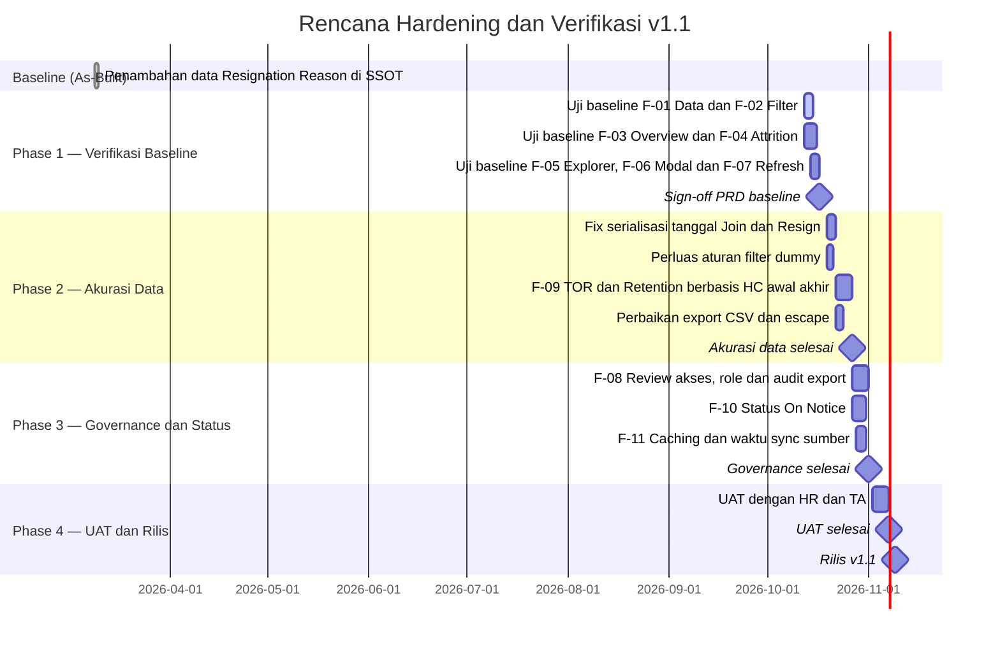

| Milestone | Target Tanggal | Deliverable |
|-----------|----------------|-------------|
| M-01: Sign-off PRD baseline | 2026-10-17 | PRD disetujui, hasil uji baseline F-01–F-07 terdokumentasi |
| M-02: Akurasi data | 2026-10-27 | Fix tanggal, aturan dummy, F-09, perbaikan export |
| M-03: Governance | 2026-11-01 | F-08 (akses/role/audit), F-10 (On Notice), F-11 (caching, waktu sync) |
| M-04: UAT | 2026-11-07 | Hasil UAT bersama HR dan TA, rekonsiliasi angka vs SSOT |
| M-05: Rilis v1.1 | 2026-11-09 | Re-deploy Web App dan catatan rilis |

---

## 15. Open Questions

Pertanyaan dan **asumsi yang dibuat** selama penyusunan PRD ini. Semua perlu konfirmasi sebelum PRD di-sign-off.

| ID | Pertanyaan / Asumsi | Ditujukan ke | Deadline | Status |
|----|---------------------|--------------|----------|--------|
| Q-01 | Pengaturan deployment Web App (Execute as / Who has access) belum terlihat di kode. Asumsi: akses dibatasi akun Google tertentu. Apakah `?data=1` terbuka luas? | HRIS Admin | 2026-10-14 | ⏳ Menunggu |
| Q-02 | Zona waktu script (`appsscript.json`) belum diketahui. Asumsi: Asia/Jakarta sehingga R-01 berlaku. Mohon verifikasi dengan membandingkan Resign Date 1 hari bulan di sheet vs dashboard | HRIS Admin | 2026-10-14 | ⏳ Menunggu |
| Q-03 | Rumus TOR dan Retention resmi perusahaan? Asumsi: mengacu praktik ISO 30414 (leaver ÷ rata-rata HC awal–akhir) | Head of HR | 2026-10-16 | ⏳ Menunggu |
| Q-04 | Karyawan Active dengan Resign Date di masa depan (snapshot: 1 record) apakah dihitung "resign terjadwal"? Asumsi: tidak dihitung sampai Last Day | HR Business Partner | 2026-10-16 | ⏳ Menunggu |
| Q-05 | Aturan baku record dummy/uji (Job Level "Dummy", Join Date 1900)? Asumsi: semuanya harus dikeluarkan | HRIS Admin | 2026-10-16 | ⏳ Menunggu |
| Q-06 | Persona (HR Ops, HRBP, TA, C-Level, Finance/Workforce Planning) diturunkan dari kode, bukan hasil riset pengguna. Apakah sesuai, dan siapa pengguna aktual? | Product Owner | 2026-10-16 | ⏳ Menunggu |
| Q-07 | Apakah nama, agama, dan status pernikahan individual boleh tampil untuk semua pengguna dashboard? Asumsi: perlu role-based access | Head of HR / Legal | 2026-10-21 | ⏳ Menunggu |
| Q-08 | Kebijakan export CSV: siapa berhak dan apakah perlu audit trail? Asumsi: ya | Head of HR | 2026-10-21 | ⏳ Menunggu |
| Q-09 | Struktur Offboarding Form dan kunci lookup `Mapping: MPP Role to CM` belum terlihat (hanya tautan di Guideline). Perilaku saat sync gagal diasumsikan "data lama bertahan" | HRIS Admin | 2026-10-21 | ⏳ Menunggu |
| Q-10 | Tanggal rilis fix `resignDate` (v5 FIXED) dan riwayat versi sebelumnya tidak tercatat. Mohon tanggal dan versi untuk Changelog | HRIS Admin | 2026-10-16 | ⏳ Menunggu |
| Q-11 | HTML yang diunggah kehilangan karakter `$` pada template literal; asumsi handler berfungsi normal. Mohon berkas sumber asli | HRIS Admin | 2026-10-14 | ⏳ Menunggu |
| Q-12 | Target KPI, jadwal v1.1, dan konfigurasi font/warna adalah usulan PM. Mohon persetujuan; Author/Reviewer/Stakeholder masih `[TBD]` | Product Owner | 2026-10-16 | ⏳ Menunggu |
| Q-13 | Apakah Overview seharusnya tetap menampilkan 5 KPI saja, atau perlu KPI tambahan (mis. rasio Outsource vs Permanent)? | C-Level / HR Head | 2026-10-21 | ⏳ Menunggu |
| Q-14 | Apakah karyawan Outsource (3.238 dari 4.180 record, 139 aktif) termasuk headcount dan TOR, atau perlu dipisah? | Head of HR | 2026-10-16 | ⏳ Menunggu |
| Q-15 | Setelah On Notice aktif: apakah On Notice dihitung "Aktif"? Apakah Explorer perlu mendukung filter Resign Saja? | Head of HR | 2026-10-21 | ⏳ Menunggu |

---

## Changelog

| Versi | Tanggal | Perubahan | Author |
|-------|---------|-----------|--------|
| 1.0.0 | 2026-10-11 | Dokumen awal dibuat melalui reverse-engineering Apps Script v5 FIXED, frontend `WebApp Demographic`, dan SSOT | [TBD] |

### Release Notes Produk (As-Built)

#### Apps Script v5 FIXED — Perbaikan Parsing dan Kalkulasi Resign Date
> Tanggal rilis tidak tercatat di artefak (Q-10).

| Aspek | Sebelum | Sesudah |
|-------|---------|---------|
| Parsing | Kolom L (Resign Date) tidak diparse di `parseRow()` | `parseDate(row[COL.resignDate])` dipanggil; hasil disimpan sebagai `YYYY-MM-DD`, atau teks mentah bila tidak bisa diparse |
| Payload `getData()` | Field `resignDate` **tidak** dikirim | `resignDate` ditambahkan ke setiap item `employees[]` (ditandai `✅ FIX`) |
| Format tanggal | Beragam | `parseDate()` menangani `Date`, angka serial Sheets/Excel (epoch 25569), string `Date`, dan `dd/mm/yyyy` / `dd-mm-yyyy` / `dd.mm.yyyy` |
| Fallback status | n/a | Bila kolom A tidak dikenali, status aktif diputuskan dari Full Name terisi dan Resign Date kosong |
| Dampak ke Attrition | Penyaringan resign berbasis rentang tanggal tidak dapat bekerja karena frontend tidak menerima Resign Date, sehingga Total Resign, TOR, dan chart resign per periode tidak akurat | Frontend memfilter resign berdasarkan **Resign Date** dalam rentang yang dipilih; modal dan Export CSV menampilkan kolom Resign Date; KPI Total Resign, TOR, Retention, chart per periode, dan TOR per Posisi menjadi dapat dihitung |
| Peringatan UI | Tidak ada | Tab Attrition menampilkan "⚠️ Filter periode ini menggunakan Resign Date" |

> **Tindak lanjut yang disarankan setelah fix ini:** R-01 (pergeseran tanggal akibat `toISOString`), R-02 (rumus TOR), dan R-11 (urutan parsing string tanggal).

#### Catatan Peningkatan SSOT (sheet `Improvement Note`)

| No | Improvement | Status | Tanggal Selesai |
|----|-------------|--------|-----------------|
| 1 | Update Offboarding Form di script untuk status On Notice ke form baru | 🔵 In Progress | — |
| 2 | Tambah data Resignation Reason | ✅ Done | 2026-03-09 |
| 3 | Tambah data Branch di sheet Master Position | ✅ Done | — |
| 4 | Dashboard karyawan aktif per Org, Sub-Dept, Branch, CM | 🔵 In Progress | — |
| 5 | Update Guideline | 🔵 In Progress | — |
| 6 | Tambah sheet SSOT 001 + Offboarding | 🔵 In Progress | — |

---

*Dokumen ini adalah "living document" — akan terus diperbarui seiring perkembangan proyek. Semua perubahan signifikan harus dicatat di Changelog.*
