# PRD — Employee Demographic Dashboard (Agriaku & BBB)
> **Version:** 1.0.0 | **Status:** 🟡 Draft | **Last Updated:** 2026-10-12  
> **Author:** [TBD] | **Reviewer:** [TBD] | **Stakeholder:** [TBD]

---

## Table of Contents
1. [Overview](#1-overview)
2. [Goals & Success Metrics](#2-goals--success-metrics)
3. [Requirements](#3-requirements)
4. [Core Features](#4-core-features)
5. [User Roles & Permissions](#5-user-roles--permissions)
6. [User Flow](#6-user-flow)
7. [Screen & UI Breakdown](#7-screen--ui-breakdown)
8. [Architecture](#8-architecture)
9. [Database Schema](#9-database-schema)
10. [API Endpoints](#10-api-endpoints)
11. [Design & Technical Constraints](#11-design--technical-constraints)
12. [Out of Scope](#12-out-of-scope)
13. [Risks & Mitigations](#13-risks--mitigations)
14. [Timeline & Milestones](#14-timeline--milestones)
15. [Open Questions](#15-open-questions)

---

## 1. Overview

### Document Basis & Conventions

This PRD was produced by **reverse-engineering** the following artifacts. Every behavior described is **as-built** unless marked as a proposal.

| Artifact | Content | Used for |
|----------|---------|----------|
| Google Apps Script (v5 FIXED) | `doGet`, `getData`, `parseRow`, `parseDate`, `normalizeGender`, `buildSummary`, `COL` constant | Data layer, status rules, column mapping |
| Frontend `WebApp Demographic` (HTML/CSS/Vanilla JS) | Filters, 3 tabs, modal, CSV export | Features, calculations, UI |
| `001 - SSOT - Database Karyawan ADI & BBB (Talenta API).xlsx` | Sheets `Guideline`, `Improvement Note`, `Database Karyawan (ADI & BBB)`, master and pivot sheets | Data source, business rules for status, data snapshot |

| Label | Meaning |
|-------|---------|
| ✅ **As-Built** | Verified from code |
| 🆕 **Proposal** | PM recommendation, not present in code |
| ⚠️ **Finding** | As-built behavior that is risky or inconsistent (details in §13) |

> **Artifact integrity note:** the uploaded HTML copy lost the `$` character in several template literals (e.g. `exOpenModal(...)`, `renderTopList`). Those handlers are assumed to work as the code clearly intends (see Q-11).  
> **UI language note:** the dashboard UI labels are in Indonesian (e.g. "Aktif Saja" = Active Only, "Karyawan Aktif" = Active Employees). This PRD describes them in English and keeps data values (e.g. `Laki-laki`, `Perempuan`) verbatim.

### Problem Statement

Employee data for two entities (PT. Agriaku Digital Indonesia / ADI and PT. Benih Berkah Berseri / BBB) is pulled from the Talenta API into a single SSOT spreadsheet. Demographic and workforce-movement analysis (composition, new joiners, resignations, turnover) previously depended on manual pivots maintained by individuals inside the same workbook (`Pivot - *` sheets). As a result: figures can differ between pivot authors, every cross-dimensional question requires a new pivot, and HR, TA, and management have no standard, self-filterable view. Without this dashboard, headcount and retention decisions rely on slow manual roll-ups that are hard to audit.

### Solution Summary

A Google Apps Script web app that reads the `Database Karyawan (ADI & BBB)` sheet (SSOT) directly, normalizes the data, and presents three tabs: **Overview** (KPIs and 11 demographic charts), **Employee Attrition** (new joiner vs resign, Turnover Rate, Retention Rate), and **Data Explorer** (cross-dimensional pivot up to 3 levels). Every figure can be drilled down to employee records per segment and exported to CSV.

### Target Users

> Personas are derived from features and data structure (MMR Finance, FA Journey Level, Join/Resign Date columns). To be confirmed in Q-06.

| Persona | Description | Primary Need |
|---------|-------------|--------------|
| **HR Operations / HRIS Admin** | Owns the SSOT and script; maintains master data quality | Verify data synced from Talenta, detect anomalies (Unknown, dummy, dates), validate dashboard figures against the sheet |
| **HR Business Partner / HR Analytics** | Analyzes workforce composition and movement per Company, Dept, Sub-Dept | Cascading filters, TOR and Retention per period, resignation reasons, demographic cross-tabs |
| **Talent Acquisition** | Plans recruitment from join and resign patterns | New joiners per period, TOR per position, active headcount per Sub-Dept/Branch/Job Level |
| **C-Level / Management** | Monitors headcount summary and attrition risk | At-a-glance KPIs, new joiner vs resign trend, segmentation per Legal Entity and Company |
| **Finance / Workforce Planning** *(assumed)* | Reconciles headcount with manpower planning | Distribution by MMR Finance, Branch, Job Level |

---

## 2. Goals & Success Metrics

### Business Goals
- [ ] Provide a **single standard view** of active headcount and demographics for ADI & BBB sourced from one SSOT, replacing per-individual manual pivots.
- [ ] Provide visibility of **workforce movement** (new joiner vs resign) with TOR and Retention Rate per period, Company, and Position, based on an accurate **Resign Date**.
- [ ] Enable **self-service cross-dimensional analysis** (up to 3 levels) without building new pivots.
- [ ] Ensure dashboard figures are **reconcilable** with the SSOT and auditable (status rules and calculations documented).
- [ ] Maintain **personal data protection** for employees on drill-down and export.

### Key Performance Indicators (KPIs)

> Targets are PM proposals pending stakeholder approval (Q-12). "Not yet measured" means no measurement exists in the artifacts.

| Metric | Current Baseline | Target | How to Measure |
|--------|------------------|--------|----------------|
| Total Resign accuracy (Attrition) vs sheet | Before v5 fix: not computable because `resignDate` was not sent to the frontend. After fix: not yet reconciled | 0 variance across 3 test periods | `COUNTIFS` on Resign Date in the SSOT sheet vs the Total Resign KPI for the same range |
| Active headcount accuracy vs sheet | Not yet measured. SSOT snapshot: 256 active non-dummy | 0 variance (excluding dummy) | Compare the Active Employees KPI with `Active HC` in the `Master Position` sheet |
| Dummy records leaking into the dashboard | 35 of 47 records with Job Level "Dummy" are not filtered (SSOT snapshot) | 0 | Count dummy records in the `getData` payload after filtering |
| Initial dashboard load time | Not yet measured | < 5 seconds (p95, ~5,000 rows) | Measure from `loadData()` to render complete |
| Freshness of displayed data | Daily sync: Talenta 00:00–01:00, combined 01:00–02:00 (Guideline sheet) | Dashboard shows source sync time, max 24 hours old | Compare the "Last updated" label with the sheet sync time |
| Weekly active users | Not yet measured | [TBD] | Unique users per week (requires logging, see FR-20) |

---

## 3. Requirements

### Functional Requirements

> FR-01 to FR-16 are **as-built** (✅). FR-17 to FR-20 are **proposals** (🆕).

| ID | Category | Requirement | Priority |
|----|----------|-------------|----------|
| FR-01 | Data Ingestion (F-01) | The system reads all rows of the `Database Karyawan (ADI & BBB)` sheet via `SpreadsheetApp`, skips rows where every cell is empty, and returns a structured error if the sheet is missing or data is empty | 🔴 Must Have |
| FR-02 | Data Ingestion (F-01) | The system parses **Join Date, Resign Date, Birth Date** from `Date`, serial number, or string types, and outputs Join/Resign Date as `YYYY-MM-DD` | 🔴 Must Have |
| FR-03 | Data Ingestion (F-01) | The system derives `isActive` from the **Status (A)** column using the rules in §9.2; fallback based on Full Name present and Resign Date empty | 🔴 Must Have |
| FR-04 | Data Ingestion (F-01) | The system normalizes Gender to `Laki-laki`/`Perempuan`, fills `Unknown` for empty dimensions, and computes `age`, `ageGroup`, `los`, `losGroup` | 🔴 Must Have |
| FR-05 | Global Filter (F-02) | Company, Legal Entity, Department, Sub-Dept, Position, and Status filters (Active Only / Active & Resigned / Resigned Only) apply to Overview, Explorer, and (except Status) Attrition | 🔴 Must Have |
| FR-06 | Global Filter (F-02) | Sub-Dept and Position options narrow to the selected Department; Position options narrow to the selected Sub-Dept | 🔴 Must Have |
| FR-07 | Global Filter (F-02) | Period filter by **Join Date**: All, Per Year, Per Month, Custom Range | 🔴 Must Have |
| FR-08 | Global Filter (F-02) | Dummy records (Department/Sub-Dept = "dummy" or dummy Status Employee) are excluded from all views and filter options | 🔴 Must Have |
| FR-09 | Overview (F-03) | Show 5 KPI cards: Total Employees, Active Employees, Average Age, Average LoS, Total Sub-Dept; each card is clickable for detail | 🔴 Must Have |
| FR-10 | Overview (F-03) | Show 11 demographic charts, 2 ranked lists (Top Department, Top Branch), and a conditional Resign Reason chart | 🔴 Must Have |
| FR-11 | Attrition (F-04) | Show 4 KPIs: Total New Joiner, Total Resign, Turnover Rate, Retention Rate | 🔴 Must Have |
| FR-12 | Attrition (F-04) | Show New Joiner and Resign per period charts (stacked per Company), a combined trend, and a TOR per Position table (Top 15); Year/Month granularity; range based on Resign Date | 🔴 Must Have |
| FR-13 | Data Explorer (F-05) | Hierarchical cross-tab of 1 to 3 dimensions with percentages vs total and vs parent, plus a dynamic chart | 🔴 Must Have |
| FR-14 | Modal (F-06) | Clicking a KPI/chart/row opens a modal listing employees with search | 🔴 Must Have |
| FR-15 | Export (F-06) | The modal list can be exported to CSV | 🔴 Must Have |
| FR-16 | Refresh (F-07) | A Refresh button reloads data; loading and error states are shown | 🟠 Should Have |
| FR-17 | Governance (F-08) | 🆕 Access restricted to authorized accounts/domain; the JSON endpoint and export must not be open to non-users; sensitive attributes can be masked | 🟠 Should Have |
| FR-18 | Attrition (F-09) | 🆕 TOR computed from the average of opening and closing period headcount; Retention defined separately from TOR | 🟠 Should Have |
| FR-19 | Status (F-10) | 🆕 **On Notice** status recognized and shown as its own category | 🟠 Should Have |
| FR-20 | Observability (F-11) | 🆕 Show source sync time, payload caching, and usage logging | 🟡 Nice to Have |

**Priority Legend:**
- 🔴 **Must Have** — Required for MVP; the system cannot function without it
- 🟠 **Should Have** — Important but can be deferred to the next iteration
- 🟡 **Nice to Have** — Improves experience but is not a priority

### Non-Functional Requirements

| Category | Requirement | Target |
|----------|-------------|--------|
| **Performance** | Initial load (`getData` call + render) | < 5 seconds p95 for ~5,000 rows; re-render on filter change < 1 second |
| **Accessibility** | Supported platforms | Modern web browser (Chrome/Edge) on desktop; responsive layout at 1100px and 768px breakpoints already exists |
| **Security** | Authentication and authorization | Google account per deployment settings (as-built); target: restricted to company domain + roles |
| **Scalability** | Data volume | Currently 4,180 valid records (5,053 rows including 873 empty rows); target ≥ 10,000 records without architecture change |
| **Availability** | Uptime | Follows Google Workspace/Apps Script; service target 99% during business hours |
| **Data Accuracy** | Figure consistency | 100% match with direct computation from the SSOT in periodic reconciliation |
| **Data Freshness** | Latency from source | ≤ 24 hours (daily Talenta sync) |
| **Privacy** | Employee personal data | No NIK, bank account, address, or contact columns in the payload (as-built satisfied); names and individual demographic attributes only for authorized users |

---

## 4. Core Features

### Feature List

| ID | Feature | Brief Description | Priority | Status |
|----|---------|-------------------|----------|--------|
| F-01 | Data Ingestion & Normalization | Apps Script `getData` reads the SSOT, parses dates, derives status, age, LoS, normalization | 🔴 Must Have | ✅ Done |
| F-02 | Global Filters | Company, Entity, Dept, Sub-Dept, Position, Status, Join Date period | 🔴 Must Have | ✅ Done |
| F-03 | Overview Tab | 5 KPI cards and 11 demographic charts | 🔴 Must Have | ✅ Done |
| F-04 | Employee Attrition Tab | New Joiner vs Resign, TOR, Retention based on Resign Date | 🔴 Must Have | ✅ Done |
| F-05 | Data Explorer Tab | 3-level cross-dimensional pivot + dynamic chart | 🔴 Must Have | ✅ Done |
| F-06 | Modal Drill-Down & CSV Export | Raw data per segment and CSV download | 🔴 Must Have | ✅ Done |
| F-07 | Refresh & State Handling | Reload data, loading, and error messages | 🟠 Should Have | ✅ Done |
| F-08 | Access Control & Personal Data Protection | Restrict access, secure the JSON endpoint, export policy | 🟠 Should Have | 🔲 Not Started |
| F-09 | Standardized Attrition Metrics | TOR and Retention based on opening/closing period headcount | 🟠 Should Have | 🔲 Not Started |
| F-10 | On Notice Status | On Notice status category from the Offboarding Form | 🟠 Should Have | 🔵 In Progress (Improvement Note #1) |
| F-11 | Freshness, Caching & Usage Log | Source sync time, CacheService, usage logging | 🟡 Nice to Have | 🔲 Not Started |

**Status Legend:** 🔲 Not Started | 🔵 In Progress | ✅ Done | ❌ Cancelled

---

### F-01: Data Ingestion & Normalization
> Apps Script backend that turns spreadsheet rows into a clean JSON payload for the frontend. Only the columns the dashboard needs are sent; PII columns (NIK, address, contact, email, bank account) are excluded.

**User Story:**
> As an `HR Operations` user, I want `the dashboard to read the SSOT directly with consistent parsing rules`, so that I can `be sure dashboard figures always match the source data`.

**Acceptance Criteria:**
- [ ] `getData()` reads the sheet named exactly `Database Karyawan (ADI & BBB)` (`SHEET_NAME` constant) and returns `employees[]`, `summary`, `totalRows`, `lastUpdated`, `debug`.
- [ ] **Resign Date (column L, index 11)** is parsed by `parseDate()` and sent as `resignDate` (`YYYY-MM-DD`); if it cannot be parsed, the raw string is sent; if empty, an empty string.
- [ ] `parseDate()` handles: `Date` objects, numbers (serial, epoch 25569), strings parseable by `Date`, and the patterns `dd/mm/yyyy`, `dd-mm-yyyy`, `dd.mm.yyyy`.
- [ ] `isActive` follows §9.2 and is consistent between `employees[].isActive` and `summary.active/resigned`.
- [ ] Gender is normalized: `f|wanita|perempuan|female` → `Perempuan`; `m|laki|pria|male` → `Laki-laki`.
- [ ] Age groups: `< 25`, `25–30`, `31–35`, `36–40`, `41–45`, `> 45`. LoS groups: `< 1 tahun`, `1–3 tahun`, `3–5 tahun`, `5–10 tahun`, `> 10 tahun`.
- [ ] Employee ID uses column D; if empty, User ID (column B) is used.

**Edge Cases & Error Handling:**
- If the sheet is not found → the system must return `{ error }` listing the available sheet names.
- If rows < 2 → the system must return `{ error: "Data kosong." }` (Empty data).
- If an exception occurs → the system must return `{ error, stack }` and the frontend shows it in the error box.
- If Resign Date contains unrecognized text → the system must send the raw text and the frontend treats it as an invalid date (not counted in the resign period).
- If Birth Date is empty → `age = null`, `ageGroup = "Unknown"`, and the record is excluded from the average age.
- If column A contains a value outside `INACTIVE_STATUS`/`ACTIVE_STATUS` (e.g. "On Notice") → the system must use the fallback: active if Full Name is filled and Resign Date is empty.
- ⚠️ If the script time zone is not UTC → `toISOString()` can shift a date by one day (see R-01).

---

### F-02: Global Filters
> A single filter bar that applies across tabs.

**User Story:**
> As an `HR Business Partner`, I want to `filter by Company, Entity, Department, Sub-Dept, Position, Status, and period`, so that I can `focus on the segment I am analyzing`.

**Acceptance Criteria:**
- [ ] Company, Legal Entity, Department, Sub-Dept, Position, and Status filters work as AND.
- [ ] Dropdown options are built from **non-dummy** data, sorted alphabetically.
- [ ] Selecting a Department narrows the Sub-Dept and Position options; selecting a Sub-Dept narrows the Position options.
- [ ] Status defaults to **Active Only**; other options: Active & Resigned, Resigned Only.
- [ ] Join Date period: All / Per Year (year dropdown, descending) / Per Month (`month` input) / Custom Range (from–to, inclusive); an active-period badge and a Reset button appear when a period is used.
- [ ] A "Filter aktif: …" (active filters) summary shows in the sub-header.
- [ ] Changing a filter re-renders the currently active tab.

**Edge Cases & Error Handling:**
- If the filter combination yields 0 records → the system must show 0 KPIs and empty charts without error.
- If a record has no Join Date and a period filter is active → the record must be excluded.
- If a selected value no longer exists in the narrowed options → the selection must reset to "All".
- ⚠️ Company and Legal Entity are **not** part of the cascade; both are independent filters. "Cascading" applies only to Department → Sub-Dept → Position.
- ⚠️ The Attrition tab ignores the Status filter and the global Join Date period filter; only the organizational filters are used.

---

### F-03: Overview Tab
> Headcount summary and demographic composition.

**User Story:**
> As a `C-Level / Management` user, I want to `see KPIs and employee composition at a glance`, so that I can `understand headcount status without opening raw data`.

**Acceptance Criteria:**
- [ ] **5 KPI cards**: (1) Total Employees = record count after filters; (2) Active Employees; (3) Average Age (active, 1 decimal); (4) Average LoS in years (active); (5) Total Sub-Dept = number of unique sub-depts among active employees. Sub-text of cards 1 and 2 follows the Status filter.
- [ ] **11 canvas charts (Chart.js)**:

| # | Chart | Type | Data Basis |
|---|-------|------|------------|
| 1 | Gender | Doughnut | Active |
| 2 | Employee Status (Contract Type) | Doughnut | Active, Status Employee column (M) |
| 3 | Religion | Doughnut | Active |
| 4 | Age Group | Vertical bar (fixed order) | Active |
| 5 | Job Level | Horizontal bar, Top 12 | Active |
| 6 | Length of Service | Vertical bar (fixed order) | Active |
| 7 | Sub-Department | Horizontal bar, Top 15 | Active |
| 8 | Marital Status | Doughnut | Active |
| 9 | MMR Finance | Horizontal bar, Top 12 | Active |
| 10 | Legal Entity | Doughnut | All records after filters (active + resigned per Status filter) |
| 11 | FA Journey Level | Horizontal bar, Top 10 | Active |

- [ ] **2 ranked lists**: Top Department (10) and Top Branch (10), with proportional bars, count, and percent; clickable.
- [ ] **Resign Reason** (horizontal bar, Top 8) appears only when resigned records exist in the filtered result.
- [ ] Doughnuts show percent labels via `chartjs-plugin-datalabels` for slices > 4%; bars show `count (percent%)`.
- [ ] Clicking a KPI or chart element opens a modal (F-06) with the related employees; the Age and LoS KPIs sort the modal (oldest / longest tenure first).

**Edge Cases & Error Handling:**
- If there are no active employees → average KPIs show 0.0 and charts are empty.
- If a dimension is empty → it is grouped as `Unknown` (snapshot: 581 records without Sub-Dept; 3,779 without FA Journey Level) and **counted as one group**, including in the Total Sub-Dept KPI.
- If the Status filter = Active Only → the Resign Reason chart is not rendered.
- If Join Date is invalid → LoS = "—" and `losGroup = Unknown`.

---

### F-04: Employee Attrition Tab
> Workforce movement analysis based on **Join Date** (new joiners) and **Resign Date** (resignations).

**User Story:**
> As an `HR Business Partner`, I want to `compare new joiners with resignations and see TOR and Retention per period`, so that I can `identify periods and positions with high attrition`.

**Acceptance Criteria:**
- [ ] Controls: **Per Year / Per Month** granularity; date range `attFrom` to `attTo` (empty = all periods); Reset button; warning "Filter periode ini menggunakan Resign Date" (this period filter uses Resign Date).
- [ ] Data basis: all non-dummy records passing the organizational filters (Company, Entity, Dept, Sub-Dept, Position), **without** the global Status filter and Join Date period.
- [ ] **New Joiner** = records with Join Date within the range (if the range is empty: all records).
- [ ] **Resign** = records with `isActive = false` **and** a valid Resign Date within the range.
- [ ] 4 KPI cards:

| KPI | As-built Formula | Sub-text |
|-----|------------------|----------|
| Total New Joiner | `COUNT(joiners)` | `N periode` |
| Total Resign | `COUNT(resignedInPeriod)` | `dari N total karyawan` |
| Turn Over Rate | `resign / avgHC × 100`, `avgHC = max(1, round((currentActive + resign) / 2))` | `% (resign / avg headcount)` |
| Retention Rate | `(avgHC − resign) / avgHC × 100` | `% (karyawan yg tetap aktif)` |

- [ ] Charts: (a) New Joiner per period, stacked per Company; (b) Resign per period, stacked per Company; (c) Combined Trend line chart New Joiner vs Resign; (d) **TOR per Position Top 15** table (columns Position, Resign (period), Total HC, TOR %, proportion bar), sorted by TOR descending, only positions with resign > 0.
- [ ] Clicking the New Joiner/Resign cards, a chart segment (period × company), or a TOR row opens a modal.

**Edge Cases & Error Handling:**
- If there are no resignations in the range → the TOR table shows "Tidak ada data resign pada periode ini." (No resign data in this period).
- If Resign Date is empty or invalid → the record is not counted as a resignation in the period.
- If `avgHC` < 1 → forced to 1 to prevent division by zero.
- If an employee is Active but Resign Date is in the future (snapshot: 1 record, 2026-10-25) → not counted as resigned until the Last Day passes (consistent with the Guideline status rules).
- ⚠️ The same date range is used for **Join Date** (new joiners) and **Resign Date** (resignations), although the label mentions only Resign Date.
- ⚠️ As-built TOR uses **current** active headcount, not opening/closing period headcount; Retention = 100 − TOR; TOR per position uses the position's **total historical records** as the denominator (see R-02 and F-09).
- ⚠️ LoS in the modal for resigned employees is computed up to **today**, not up to Resign Date.

---

### F-05: Data Explorer Tab
> A pivot tool across up to 3 dimensions with a chart that adapts to the selection.

**User Story:**
> As an `HR Analytics` user, I want to `select up to three dimensions and instantly see a table and chart`, so that I can `answer ad-hoc questions without building manual pivots`.

**Acceptance Criteria:**
- [ ] Dimension 1 (required, 15 options): Department, Sub-Department, Gender, Age Group, Length of Service, Job Level, Grade, Contract Type, Religion, Marital Status, MMR Finance, Branch, Legal Entity, Company, FA Journey Level.
- [ ] Dimension 2 (optional, 12 options): Gender, Age Group, LoS, Job Level, Grade, Contract Type, Sub-Department, Department, Religion, Marital Status, MMR Finance, Branch.
- [ ] Dimension 3 (optional, 9 options): Gender, Age Group, LoS, Job Level, Grade, Contract Type, Religion, Marital Status, Position.
- [ ] Output is a hierarchical table (level 1 bold, levels 2 and 3 indented) with Count, % of Total, and a proportion bar; levels 2 and 3 show percent of parent; sorted by count descending.
- [ ] The result header shows the dimension path, total active employees, and number of top-level groups.
- [ ] **Dynamic chart**: 1 dimension → distribution bar with `count (percent%)` labels (horizontal if > 8 groups, maximum 20 groups); ≥ 2 dimensions → Dimension 1 × Dimension 2 bar with **Stacked / Grouped / 100%** modes (horizontal if > 6 groups). Dimension 3 appears only in the table.
- [ ] Clicking a table row or chart segment opens a modal for the related slice.
- [ ] Explorer runs automatically when the tab opens and when global filters change.

**Edge Cases & Error Handling:**
- If there are no active employees under the filters → show "Tidak ada data aktif pada filter ini." (No active data for these filters) and hide the chart.
- If Status filter = Resigned Only → Explorer still uses only active employees, so it is empty (⚠️ as-built behavior; see Q-15).
- If a dimension is empty → group `Unknown`.
- If Dimension 2/3 equals Dimension 1 → the system produces an uninformative hierarchy (no validation yet; proposal: prevent duplicate selection).

---

### F-06: Modal Drill-Down & CSV Export
> Employee details per segment and data download.

**User Story:**
> As an `HR Business Partner`, I want to `see and download the list of employees behind a figure`, so that I can `verify and follow up on the data`.

**Acceptance Criteria:**
- [ ] The modal shows a title, subtitle (count), search box, table, and footer "Menampilkan N karyawan" (Showing N employees).
- [ ] Columns: Name, Department, Sub-Dept, Position, Job Level, Gender, Age, LoS (yrs), Join Date, Resign Date, Branch, Status (Active/Resign badge).
- [ ] Search filters by name, department, sub-dept, position, branch.
- [ ] The modal closes via the ✕ button, an overlay click, or the `Esc` key.
- [ ] The **Export CSV** button downloads a UTF-8 BOM file with 18 columns: Name, Department, Sub Dept, Position, Job Level, Gender, Age, LoS (yrs), Join Date, Resign Date, Status, Branch, Legal Entity, Religion, Marital Status, MMR Finance, Contract Type, FA Journey Level. File name: `export_<modal title>.csv`.

**Edge Cases & Error Handling:**
- If search returns nothing → the table is empty and the footer shows "Menampilkan 0 karyawan".
- If a cell value is empty → the modal shows `-`.
- ⚠️ Export filters only by **name and department**, while modal search covers 5 columns → the export can differ from what is visible.
- ⚠️ Quote escaping in CSV uses `\"` instead of `""` → columns can break in Excel when a value contains a quote.
- ⚠️ The modal renders cell values via `innerHTML` without `esc()` → risk of HTML injection from source data.
- If the modal is opened from a chart segment → the list follows the clicked segment, not the full data.

---

### F-07: Refresh & State Handling
> Loading data, showing loading and error states.

**User Story:**
> As a `dashboard user`, I want to `reload data and get a clear message on failure`, so that I can `tell whether the problem is access, data, or the script`.

**Acceptance Criteria:**
- [ ] Data loads automatically when the page opens; the **↻ Refresh Data** button reloads and is disabled while loading.
- [ ] The header shows "Last updated: <time> · N baris total" (N total rows).
- [ ] LoS is recomputed in the browser from Join Date on every load (`losLive`, `losDisplay`, `losGroup`).
- [ ] Filter options are rebuilt after data arrives.

**Edge Cases & Error Handling:**
- If the page is opened as a plain HTML file (not a Web App) → show instructions to open the deployment URL.
- If `getData` returns nothing → "Apps Script tidak mengembalikan data."
- If `data.error` → show the message and stack.
- If `employees` is not an array → "Format data tidak valid".
- If the call fails (`withFailureHandler`) → show the error message and re-enable the button.
- ⚠️ "Last updated" is the script execution time, **not** the source data sync time.

---

### F-08: Access Control & Personal Data Protection 🆕
> The dashboard exposes individual names, ages, religion, and marital status, plus the `?data=1` JSON endpoint. Access needs to be locked down and audited.

**User Story:**
> As an `HRIS Admin`, I want to `restrict who can view and export individual-level data`, so that I can `meet personal data protection and access control obligations`.

**Acceptance Criteria:**
- [ ] Deployment is restricted to authorized domain/accounts; the access mode is documented.
- [ ] The `?data=1` endpoint is protected (token/role) or disabled in production.
- [ ] Minimum roles: Aggregate Viewer (no names), Detail Viewer, Admin.
- [ ] CSV export is available only to authorized roles and is logged (who, when, segment).
- [ ] `XFrameOptionsMode.ALLOWALL` is reviewed; embedding is allowed only for approved domains.

**Edge Cases & Error Handling:**
- If a user without the detail role opens a modal → the system must show aggregates without the name column.
- If an unregistered user accesses `?data=1` → the system must reject (HTTP 403 or a structured error message).

---

### F-09: Standardized Attrition Metrics 🆕
> Aligns TOR and Retention with human capital reporting practice (consistent with ISO 30414: turnover = number of leavers ÷ average headcount for the period).

**User Story:**
> As a `C-Level / Management` user, I want `TOR and Retention computed with a standard definition`, so that I can `compare fairly across periods and entities`.

**Acceptance Criteria:**
- [ ] `HC(D)` = number of non-dummy records with `Join Date ≤ D` and (`Resign Date` empty or `> D`).
- [ ] `TOR = leavers_in_period ÷ ((HC(start) + HC(end)) ÷ 2) × 100`.
- [ ] Retention is defined separately: `(HC(start) − leavers from the HC(start) cohort) ÷ HC(start) × 100`.
- [ ] TOR per Position uses the position's average headcount over the same period.
- [ ] The formula footnote is shown in the UI; old and new results can be compared during UAT.
- [ ] Option for annualized TOR when the range is not 12 months.

**Edge Cases & Error Handling:**
- If `HC(start) = 0` → show "n/a", not 0%.
- If Resign Date < Join Date → the row is flagged as an anomaly and excluded from the calculation with a warning.
- If the range extends into the future → HC(end) is capped at today.

---

### F-10: On Notice Status 🆕
> The `Guideline` sheet defines 3 statuses (Active / Inactive / On Notice) and the master sheets have an `On Notice HC` column, but the script does not recognize On Notice yet.

**User Story:**
> As a `Talent Acquisition` user, I want to `see employees who have submitted resignation but have not reached their Last Day`, so that I can `prepare backfills early`.

**Acceptance Criteria:**
- [ ] `"on notice"` is recognized explicitly in `parseRow` (not via the fallback) and sent as `statusGroup = "On Notice"`.
- [ ] The Status filter gains an On Notice option; the Active KPI keeps including On Notice per the Guideline definition (Q-15).
- [ ] Attrition shows "Scheduled resign" separately from realized resignations.
- [ ] The new Offboarding Form source is integrated (Improvement Note #1 In Progress).

**Edge Cases & Error Handling:**
- If an Employee ID is in the Offboarding Form and Resign Date is filled → the Resign Date rule wins (per Guideline steps 1–2).
- If the Offboarding Form cannot be read during sync → status stays as of the last sync and a warning is shown.

---

### F-11: Freshness, Caching & Usage Log 🆕

| Item | Description |
|------|-------------|
| Source sync time | Show the `Updated At` / sync time of Database Karyawan, not the script execution time |
| Caching | `CacheService` (short TTL) for the payload so the whole sheet is not read on every load |
| Usage log | Record user, time, tab, and exports (supports the adoption KPI and audit) |

---

## 5. User Roles & Permissions

> **As-built there is no RBAC**: every account passing the deployment access setting sees all features, including employee names and export. The matrix below shows the as-built state; the last column is the proposed target for F-08.

```
┌─────────────────────────────────────────────────────────────┐
│                    ROLE HIERARCHY                            │
│                                                             │
│  👑 HRIS Admin (Spreadsheet & Script Owner)                 │
│     └── Manages SSOT, script, deployment, access            │
│                                                             │
│  👤 Dashboard User (HR / TA / C-Level)                      │
│     └── All tabs, filters, drill-down, export (as-built)    │
│                                                             │
│  👁️  Aggregate Viewer (🆕 Proposal)                         │
│     └── Aggregate figures only, no names and no export      │
└─────────────────────────────────────────────────────────────┘
```

| Feature / Action | HRIS Admin | Dashboard User (as-built) | Aggregate Viewer (🆕) |
|---|:---:|:---:|:---:|
| Open the Web App (per deployment permission) | ✅ | ✅ | ✅ |
| Use Global Filters | ✅ | ✅ | ✅ |
| View Overview, Attrition, Explorer | ✅ | ✅ | ✅ |
| Refresh Data | ✅ | ✅ | ✅ |
| Drill-down modal (individual names) | ✅ | ✅ | ❌ |
| Export CSV | ✅ | ✅ | ❌ |
| Access JSON endpoint `?data=1` | ✅ | ✅ | ❌ |
| Edit SSOT / source sheet data | ✅ | ❌ | ❌ |
| Change script / re-deploy | ✅ | ❌ | ❌ |
| Manage deployment access | ✅ | ❌ | ❌ |

---

## 6. User Flow

### 6.1 High-Level User Journey

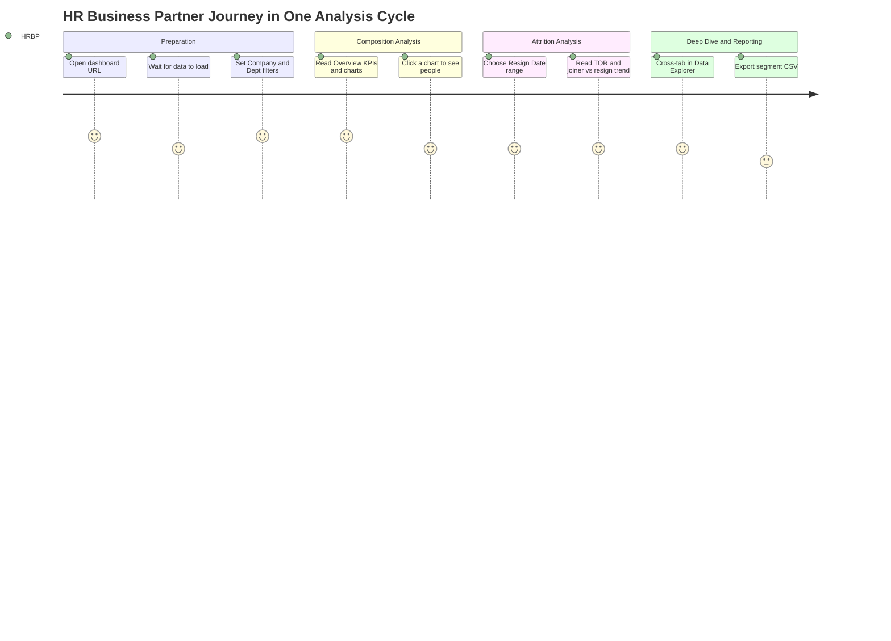

---

### 6.2 Authentication Flow

> The dashboard has no login of its own; authentication is handled entirely by the Google Apps Script deployment settings (Q-01).

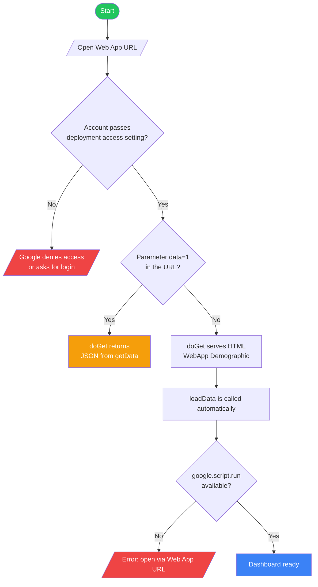

---

### 6.3 Main Application Flow

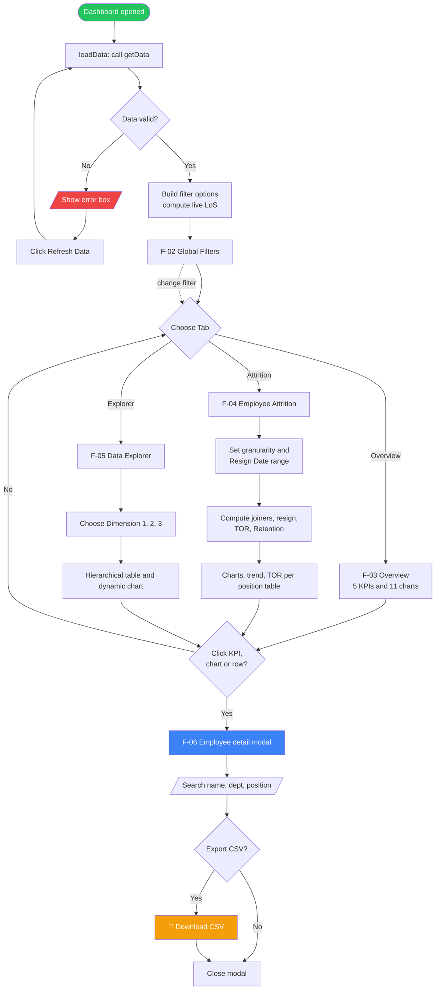

---

### 6.4 Critical Sub-Flow: Data Loading & Normalization (F-01, F-07)

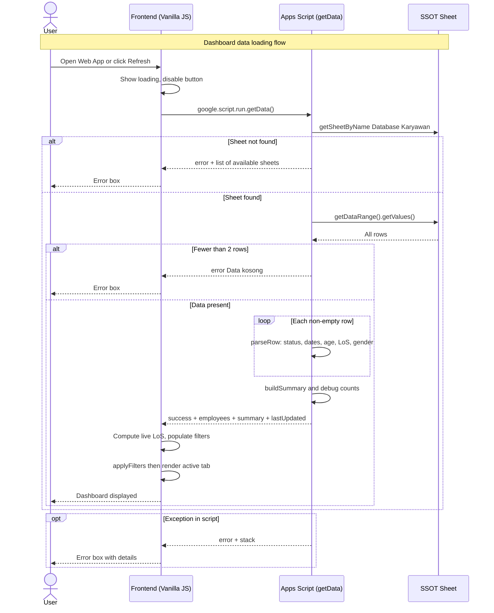

---

### 6.5 Critical Sub-Flow: Attrition Calculation (F-04)

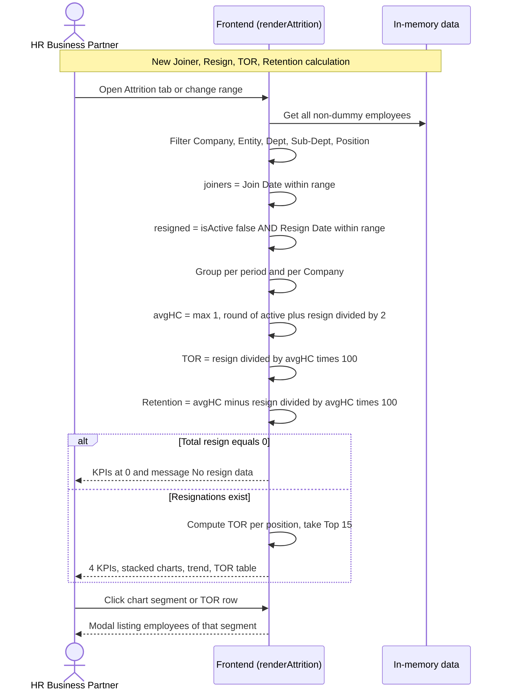

---

### 6.6 Critical Sub-Flow: Drill-Down & CSV Export (F-06)

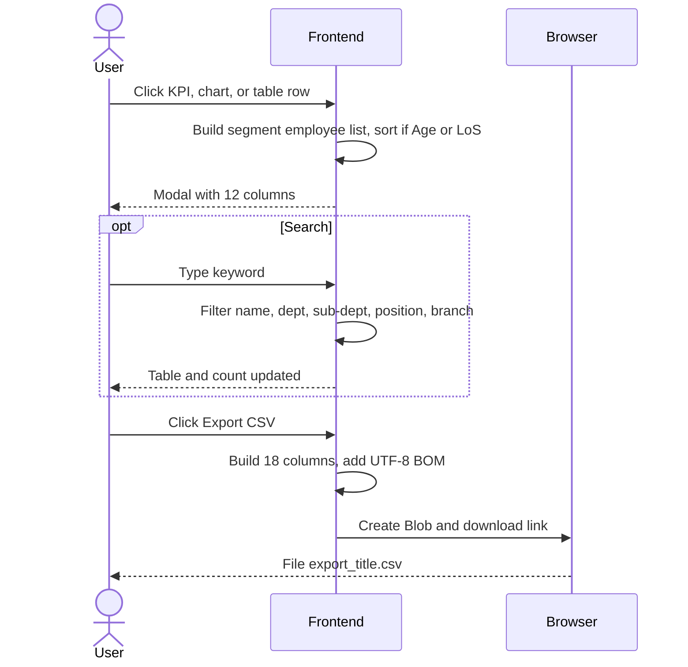

---

### 6.7 Critical Sub-Flow: SSOT Sync from Talenta (upstream data, per the `Guideline` sheet)

> This process runs outside the dashboard but determines the quality of every figure. Schedule and status rules come from the `Guideline` sheet.

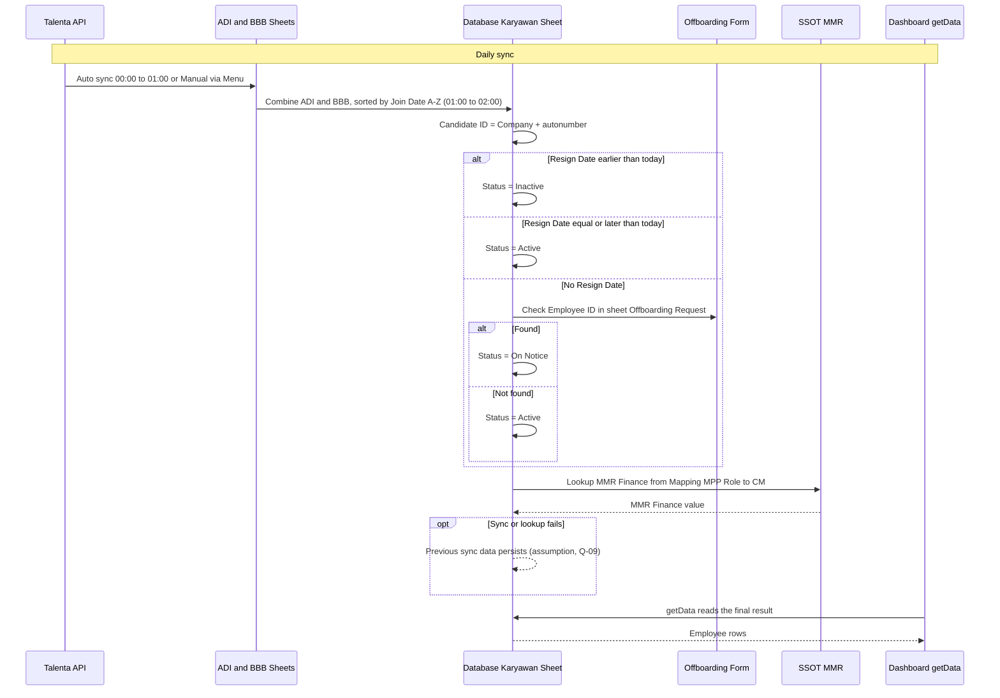

---

## 7. Screen & UI Breakdown

### Screen List

> Single-page application; tab switching happens client-side without URL changes.

| ID | Screen Name | Route / Path | Brief Description |
|----|-------------|--------------|-------------------|
| S-01 | Dashboard Shell | `<web-app-url>/exec` | Header, sub-header (filter summary + Refresh), tab bar, filter bar, KPI area |
| S-02 | Overview Tab | Tab "📊 Overview" | 5 KPI cards, 11 charts, 2 ranked lists, conditional Resign Reason |
| S-03 | Employee Attrition Tab | Tab "📉 Employee Attrition" | Granularity and range controls, 4 KPIs, New Joiner/Resign/Trend charts, TOR per Position table |
| S-04 | Data Explorer Tab | Tab "🔍 Data Explorer" | 3-dimension controls, dynamic chart, hierarchical table |
| S-05 | Data Detail Modal | Overlay | Employee list, search, Export CSV |
| S-06 | Loading / Error State | Content area | Spinner and error box |
| S-07 | JSON Data Endpoint | `<web-app-url>/exec?data=1` | JSON output of `getData` (not a UI) |

### Wireframe / Layout Notes

**S-02: Overview Tab**
```
┌─────────────────────────────────────────────────────────────────┐
│ Agriaku & BBB — Employee Demographic Dashboard                  │
│ Last updated: <time> · N rows total                             │
├─────────────────────────────────────────────────────────────────┤
│ Active filters: ...                              [↻ Refresh Data]│
├─────────────────────────────────────────────────────────────────┤
│ [📊 Overview] [📉 Employee Attrition] [🔍 Data Explorer]        │
├─────────────────────────────────────────────────────────────────┤
│ Filter: [Company▼][Entity▼][Dept▼][Sub-Dept▼][Position▼][Status▼]│
│ Join Period: (All)(Per Year)(Per Month)(Custom Range) [Reset]  │
├─────────────────────────────────────────────────────────────────┤
│ ┌────────┐ ┌────────┐ ┌────────┐ ┌────────┐ ┌────────┐         │
│ │ Total  │ │ Active │ │  Avg   │ │  Avg   │ │ Total  │         │
│ │Employees│ │        │ │  Age   │ │  LoS   │ │Sub-Dept│         │
│ └────────┘ └────────┘ └────────┘ └────────┘ └────────┘         │
│                                                                 │
│ ┌─Gender──┐ ┌─Contract Type─┐ ┌─Religion─┐                      │
│ └─────────┘ └───────────────┘ └──────────┘                      │
│ ┌─Age Group─┐ ┌─Top Department (ranked list)───┐               │
│ ┌─Job Level─┐ ┌─Length of Service─┐                             │
│ ┌─Sub-Dept Top 15─┐ ┌─Marital Status─┐                         │
│ ┌─MMR Finance─┐ ┌─Legal Entity─┐                                │
│ ┌─Top Branch─┐ ┌─FA Journey Level─┐                             │
│ ┌─Resign Reason (only when resignations exist)─┐                │
└─────────────────────────────────────────────────────────────────┘
```

**S-03: Employee Attrition Tab**
```
┌─────────────────────────────────────────────────────────────────┐
│ Granularity: (Per Year)(Per Month) │ Resign Date range:         │
│ [from] to [to] [✕ Reset]  ⚠️ This filter uses Resign Date       │
├─────────────────────────────────────────────────────────────────┤
│ ┌─New Joiner─┐ ┌──Resign──┐ ┌─Turn Over─┐ ┌─Retention─┐        │
│ └────────────┘ └──────────┘ └───────────┘ └───────────┘        │
│ ┌─New Joiner per Period─┐ ┌─Resign per Period─┐                │
│ ┌─Combined Trend: New Joiner vs Resign──────────┐               │
│ ┌─TOR per Position Top 15 (Position|Resign|HC|TOR%|bar)─┐      │
└─────────────────────────────────────────────────────────────────┘
```

---

## 8. Architecture

### System Architecture Overview

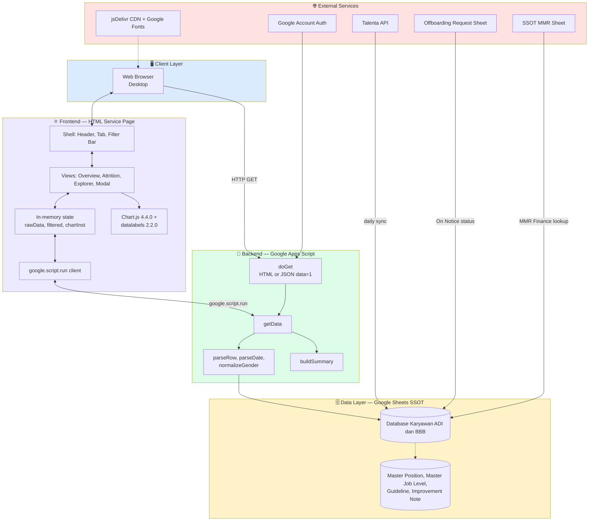

### Data Flow — Core Request Cycle

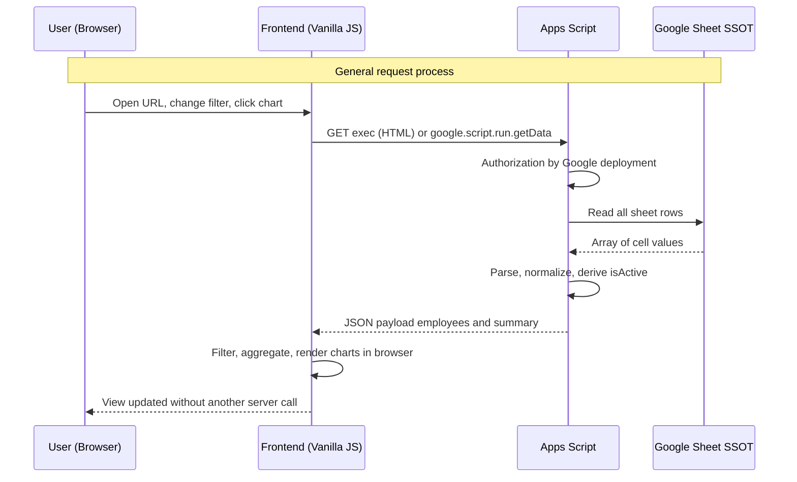

> After the payload is loaded, **all filtering, aggregation, and charting is computed in the browser**; the server is only called on load/Refresh.

---

## 9. Database Schema

> There is no RDBMS. The "database" is the Google Sheet that serves as the SSOT. The model below is the **logical model** of the sheet.

### 9.1 Data Source — Single Source of Truth

| Attribute | Value |
|-----------|-------|
| SSOT file | **`001 - SSOT - Database Karyawan ADI & BBB (Talenta API).xlsx`** (spreadsheet; the script is bound to the spreadsheet via `getActiveSpreadsheet`) |
| Sheet read by the dashboard | `Database Karyawan (ADI & BBB)` (`SHEET_NAME` constant) |
| Data origin | Talenta API → sheets `ADI` and `BBB` → combined into `Database Karyawan (ADI & BBB)`, sorted by Join Date A–Z |
| Sync schedule | ADI and BBB: daily 00:00–01:00; combined: daily 01:00–02:00; manual via menu |
| Related sheets (not read by the dashboard) | `Guideline`, `Improvement Note`, `Master Job Level`, `Master Position`, `SSOT MMR`, and other pivot/supporting sheets |
| Volume snapshot | 4,180 valid records (3,039 ADI, 1,141 BBB); 289 Active, 3,891 Inactive; 51 dummy records; 873 empty rows in the sheet range |

### 9.2 Status Rules (Guideline sheet vs code)

**Source rules (`Guideline`) — column A `Status (Active/Inactive/On Notice)`:**
1. `Resign Date` (Last Day) < today → **Inactive**
2. `Resign Date` ≥ today → **Active**
3. No Resign Date and Employee ID is in the Offboarding Form (sheet `Offboarding Request (ADI & BBB)`) → **On Notice**
4. Otherwise → **Active**

**Code rules (`parseRow`) for `isActive`:**

| Order | Condition (column A, lowercase, `includes`) | Result |
|-------|---------------------------------------------|--------|
| 1 | Contains any `INACTIVE_STATUS`: resign, resigned, inactive, terminated, non-active, nonactive, tidak aktif, off, keluar, dummy, dummy contract, dummy probation | `isActive = false` |
| 2 | Contains any `ACTIVE_STATUS`: aktif, active, contract, permanent, freelance, internship, outsource, probation, pkwt, pkwtt | `isActive = true` |
| 3 | Fallback: Full Name filled **and** Resign Date empty | `isActive = true`, otherwise `false` |

> ⚠️ Column **A (Status)** determines active/inactive. Column **M (Status Employee)** is the **contract type** and is sent as `status`/`contractType` to the frontend. The two are easily confused.  
> ⚠️ Substring matching is brittle: the value "On Notice" matches no list (falls to the fallback), and any value containing "off" (e.g. "Offboarding") becomes inactive.

### 9.3 Key Column Mapping (`COL` variable)

| Index | Column | SSOT Header | `COL` Variable | Frontend Payload | Notes |
|:---:|:---:|-------------|----------------|------------------|-------|
| 0 | A | Status | `status` | `isActive` (derived) | **Primary status** Active/Inactive/(On Notice); not sent raw |
| 1 | B | User ID | `userId` | `id` (fallback) | Used when Employee ID is empty |
| 3 | D | Employee ID | `employeeId` | `id` | |
| 4 | E | Full Name | `fullName` | `name` | Used in the status fallback |
| 5 | F | Organization | `organization` | `department` | Department dimension; "dummy" is filtered |
| 6 | G | Sub-Department | `subDepartment` | `subDept` | |
| 7 | H | Project | `project` | `project` | Sent, not yet used by the UI |
| 8 | I | Position | `position` | `position` | Filter, Explorer Dim 3, TOR per position |
| 9 | J | Job Level | `jobLevel` | `jobLevel` | |
| 10 | K | **Join Date** | `joinDate` | `joinDate` (`YYYY-MM-DD`) | Basis for Join period, New Joiner, LoS |
| 11 | L | **Resign Date** | `resignDate` | `resignDate` (`YYYY-MM-DD`) | Basis for resignations in Attrition; parsed since the v5 fix |
| 12 | M | Status Employee | `statusEmployee` | `status`, `contractType` | **Contract type**: Permanent, Contract, Outsource, Probation, Internship, Freelance, Dummy |
| 15 | P | Birth Date | `birthDate` | `age`, `ageGroup` | Birth date not sent; only derived age |
| 21 | V | Branch Name | `branchName` | `branch` | |
| 22 | W | MMR Location | `mmrLocation` | `location` | Sent, not yet used by the UI |
| 23 | X | Religion | `religion` | `religion` | |
| 24 | Y | Gender | `gender` | `gender` | Normalized |
| 25 | Z | Marital Status | `maritalStatus` | `maritalStatus` | |
| 27 | AB | Length Of Service | `lengthOfService` | `los` | Used if filled; the frontend recomputes LoS from Join Date |
| 31 | AF | Grade | `grade` | `grade` | |
| 33 | AH | MMR Finance | `mmrFinance` | `mmrFinance` | Lookup result from SSOT MMR |
| 34 | AI | FA Journey Level | `faJourneyLevel` | `faJourneyLevel` | Mostly empty (Unknown) |
| 35 | AJ | Legal Entity | `legalEntity` | `legalEntity` | |
| 36 | AK | Company | `company` | `company` | ADI or BBB |
| 37 | AL | Resignation Reason | `resignReason` | `resignReason` | Resign Reason chart |

**Defined in `COL` but not sent to the frontend:** Candidate ID (C), End Date (N), Email (O), Birth Place (Q), Citizen ID Address (R), Residential Address (S), NIK (T), Mobile Phone (U), Blood Type (AA), Approval Line (AC), Manager Name (AD), Manager Email (AE), Profile Picture (AG), Resignation Reason Detail (AM).  
**Present in the sheet but not in `COL`:** Bank Name, Account Number, Account Holder Name (AN–AP) — not read by the script. Keep it that way (see §11 Security).

### Entity Relationship Diagram (ERD)

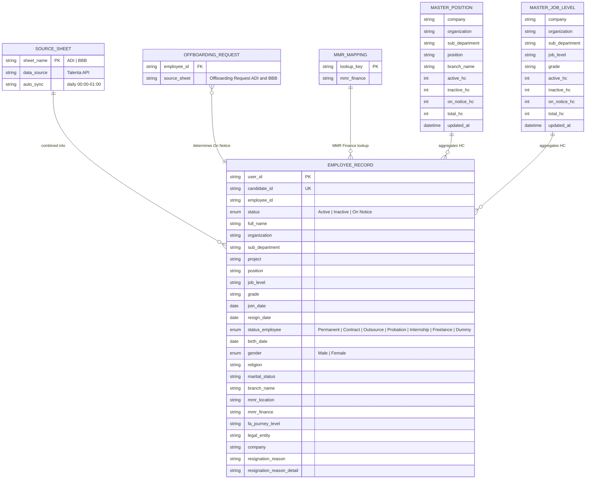

### Table Descriptions

| Table (Sheet) | Description | Key Columns |
|---------------|-------------|-------------|
| **SOURCE_SHEET** (`ADI`, `BBB`) | Raw sheets from the Talenta API sync, per company | `sheet_name`, sync schedule |
| **EMPLOYEE_RECORD** (`Database Karyawan (ADI & BBB)`) | Combined SSOT; one row per employee/contract. The only sheet read by the dashboard | `user_id`, `candidate_id` (Company + autonumber), `employee_id`, `status`, `join_date`, `resign_date` |
| **OFFBOARDING_REQUEST** (`Offboarding Request (ADI & BBB)`, separate spreadsheet) | List of employees who have submitted offboarding; determines On Notice. Other columns unknown (Q-09) | `employee_id` |
| **MMR_MAPPING** (`Mapping: MPP Role to CM` in SSOT MMR) | Lookup table for MMR Finance values. Lookup key is assumed (Q-09) | `lookup_key`, `mmr_finance` |
| **MASTER_POSITION** | Headcount roll-up per Company/Org/Sub-Dept/Position/Branch (Active, Inactive, On Notice, Total) | `position`, `branch_name`, `updated_at` |
| **MASTER_JOB_LEVEL** | Headcount roll-up per Company/Org/Sub-Dept/Job Level/Grade | `job_level`, `grade`, `updated_at` |

> `EMPLOYEE_RECORD` columns not shown in the ERD (PII) are listed in §9.3. Other supporting sheets (`Pivot *`, `PKWT *`, `Reporting Line Hierarchy`, `Sub-Dept PIC`, `Master Data - HR`, etc.) are outside the dashboard scope.

### Indexing Strategy

N/A: there is no relational database. The equivalent performance strategy:

```sql
-- Logical equivalent (not executed): queries the dashboard performs in browser memory
-- 1. Organization filter:    WHERE company = ? AND legal_entity = ? AND organization = ? AND sub_department = ? AND position = ?
-- 2. Active headcount:       WHERE is_active = true
-- 3. Resign per period:      WHERE is_active = false AND resign_date BETWEEN ? AND ?
-- 4. New joiner per period:  WHERE join_date BETWEEN ? AND ?
-- Recommendation: keep Status, Join Date, Resign Date in the source sheet as proper Date/standard text;
-- avoid trailing empty rows (getDataRange reads 5,053 rows for 4,180 records).
```

---

## 10. API Endpoints

> There is no REST API. The actual interfaces are the Apps Script Web App and one server function called via `google.script.run`.

### Web App (`doGet`)
| Method | Endpoint | Description | Auth |
|--------|----------|-------------|------|
| `GET` | `<web-app-url>/exec` | Serves the `WebApp Demographic` HTML page (`XFrameOptionsMode.ALLOWALL`) | ⚠️ Per deployment setting (Q-01) |
| `GET` | `<web-app-url>/exec?data=1` | Returns JSON from `getData()` | ⚠️ Per deployment setting (Q-01) |

### Server Function (`google.script.run`)
| Method | Function | Description | Auth |
|--------|----------|-------------|------|
| `RPC` | `getData()` | Reads the SSOT sheet and returns the employee payload + summary | ✅ User's Google session |

### Internal Functions (not endpoints)
| Function | Role |
|----------|------|
| `parseRow(row)` | Normalizes one row |
| `parseDate(raw)` | Parses Date/serial/string/`dd-mm-yyyy` dates |
| `normalizeGender(raw)` | Gender normalization |
| `buildSummary(employees)` | `summary` aggregates (currently unused by the frontend, which recomputes its own) |

### Example Request & Response

**`getData()` / `GET /exec?data=1`**
```json
// Response 200 OK (abridged; sample values anonymized)
{
  "success": true,
  "lastUpdated": "2026-10-11T05:00:00.000Z",
  "totalRows": 4180,
  "debug": {
    "headerCheck": {
      "colA_status": "Status",
      "colM_statusEmp": "Status Employee",
      "colL_resignDate": "Resign Date",
      "colAH_mmrFinance": "MMR Finance"
    },
    "uniqueStatuses": ["Contract", "Outsource", "Permanent"],
    "uniqueContractTypes": ["Contract", "Outsource", "Permanent"],
    "activeCount": 289,
    "resignedCount": 3891
  },
  "summary": { "total": 4180, "active": 289, "resigned": 3891, "avgAge": 0, "avgLoS": 0 },
  "employees": [
    {
      "id": "EMP-0001",
      "name": "Employee Name",
      "department": "COMMERCIAL",
      "subDept": "Agrochemical",
      "project": "Unknown",
      "position": "Sample Position",
      "jobLevel": "(15a - F) Associate Manager OR Specialist - IC",
      "grade": "F",
      "gender": "Laki-laki",
      "religion": "Unknown",
      "maritalStatus": "Unknown",
      "age": 31,
      "ageGroup": "31–35",
      "los": "2.4",
      "losGroup": "1–3 tahun",
      "joinDate": "2024-05-01",
      "resignDate": "2026-10-25",
      "status": "Permanent",
      "contractType": "Permanent",
      "branch": "Pusat",
      "location": "Unknown",
      "mmrFinance": "Unknown",
      "legalEntity": "PT. Agriaku Digital Indonesia",
      "company": "PT. Agriaku Digital Indonesia",
      "resignReason": "",
      "faJourneyLevel": "Unknown",
      "isActive": true
    }
  ]
}

// Error response (sheet not found)
{ "error": "Sheet \"Database Karyawan (ADI & BBB)\" tidak ada. Sheet tersedia: Guideline, ADI, BBB" }

// Error response (empty data)
{ "error": "Data kosong." }

// Error response (exception)
{ "error": "<message>", "stack": "<stack trace>" }
```

> ⚠️ Inconsistent envelope: success uses `success: true`, while errors use only `error` (no `success: false` and no code). Proposal for v1.1: `{ success:false, error:{ code, message } }` with codes `SHEET_NOT_FOUND`, `EMPTY_DATA`, `INTERNAL_ERROR`, `FORBIDDEN`.  
> ⚠️ Error responses on `?data=1` and the `stack` in the error box can leak internal details.

---

## 11. Design & Technical Constraints

### Technology Stack
| Layer | Technology Choice | Reason |
|-------|-------------------|--------|
| **Frontend** | HTML + CSS + **Vanilla JavaScript** (single `WebApp Demographic` file) | No build step; easy for the HR team to deploy and maintain |
| **Visualization** | **Chart.js 4.4.0** + **chartjs-plugin-datalabels 2.2.0** (jsDelivr CDN) | Lightweight doughnut/bar/line, percent labels on charts |
| **Backend** | **Google Apps Script Web App** (`HtmlService`, `ContentService`, `SpreadsheetApp`) | Direct integration with the Google Sheets SSOT; no own server |
| **Database** | **Google Sheets** SSOT (`Database Karyawan (ADI & BBB)`) | Single source from the Talenta sync; managed by HR |
| **ORM** | N/A | Direct `getDataRange().getValues()` reads |
| **Auth** | Google Account via Web App deployment settings | No own password management |
| **Deployment** | Apps Script Deploy → Manage Deployments (`/exec` URL) | Single-URL distribution; versions re-deployed manually |

### Typography Rules
As-built font configuration (taken from the frontend code):

| Role | Font Stack |
|------|-----------|
| **Heading** | `'Syne', sans-serif` (weights 400/600/700/800) |
| **Body** | `'DM Sans', sans-serif` (weights 300/400/500) |
| **Mono** | N/A (not used) |

As-built color tokens: `--accent1 #5BAD3A`, `--accent2 #F5A623`, `--accent3 #7DC052`, `--accent4 #E05A2B`, `--accent5 #3A8A5B`, `--bg #f2f6f0`, `--text #2C3E2D`, `--muted #7A8C7B`, `--radius 14px`; 15-color green/orange chart palette. Fonts are loaded from Google Fonts. Confirm that this configuration is the standard (Q-12).

### Coding Standards
- **Language:** JavaScript ES6+ (Apps Script V8), no TypeScript currently
- **Structure:** one HTML file (inline CSS + JS) and one `.gs` file; proposal: split into modules as features grow
- **Data convention:** all empty dimensions become `Unknown`; dates sent as `YYYY-MM-DD`
- **Testing:** none currently; proposal: figure reconciliation tests vs the sheet and date/status parsing tests (see F-09, F-10)
- **Versioning:** no file versioning; proposal: tag the version in the file header comment and record it in the Changelog
- **Output escaping:** use `esc()` for every value rendered via `innerHTML`

### Security Constraints
- **As-built:** authentication by Google; `XFrameOptionsMode.ALLOWALL`; the payload excludes NIK, address, contact, email, bank account (must be preserved).
- **Required (proposal F-08):** access restricted to authorized domain/accounts; `?data=1` endpoint protected or disabled; Aggregate Viewer vs Detail Viewer roles; exports logged (audit trail); error `stack` not shown to end users.
- **Personal data protection:** names, age, religion, and marital status are employee personal data; handling follows Indonesian Law No. 27 of 2022 (PDP) and internal policy; access control aligns with ISO/IEC 27001 principles (least privilege, logging).
- **Data integrity:** the dashboard is read-only; it never writes to the SSOT.
- **Sanitization:** all cell values rendered via `innerHTML` must be escaped; CSV values starting with `=`, `+`, `-`, `@` must be neutralized; quotes in CSV must be doubled (`""`).
- **Transport:** HTTPS (provided by Google).
- **External dependencies:** Chart.js, datalabels, and Google Fonts load from public CDNs; proposal: pin versions + SRI.

---

## 12. Out of Scope

The following features are **not included** in this version (as-built v5 and the v1.1 roadmap):

| Feature | Reason for Exclusion | Possible Version |
|---------|----------------------|------------------|
| Writing/correcting data back to the SSOT from the dashboard | Dashboard is designed read-only to protect master data integrity | Not planned |
| Direct Talenta API connection from the dashboard | Sync is already handled at the SSOT layer | v2.0 |
| Attrition prediction / advanced people analytics | Needs richer historical data and a model | v2.0 |
| Compensation/salary and personal financial data analysis | Outside demographic scope and privacy-sensitive | v3.0 |
| Native mobile app | Responsive web is sufficient for current needs | v3.0 |
| Automatic notifications (email/Slack) when TOR passes a threshold | Needs threshold definition and channel | v2.0 |
| Stored historical headcount snapshots (monthly time series) | Needs separate storage; F-09 computes from join/resign dates | v1.5 |
| Reporting Line / Organization Chart dashboard | Data exists in the SSOT but is not demographic focus | v2.0 |

---

## 13. Risks & Mitigations

| ID | Risk | Impact | Likelihood | Mitigation |
|----|------|--------|------------|------------|
| R-01 | **One-day date shift**: `parseDate` produces a `Date`, then `toISOString().split("T")[0]` converts to UTC. In a UTC+7 script time zone (e.g. Asia/Jakarta), a local 00:00 date becomes the previous day, so Join/Resign Dates at the start of a month (e.g. 1 July) can fall into the previous month in monthly aggregation | 🔴 High | 🟡 Medium (depends on script time zone, Q-02) | Format dates with `Utilities.formatDate(d, Session.getScriptTimeZone(), "yyyy-MM-dd")`; test with month-start/month-end dates |
| R-02 | **Non-standard TOR/Retention**: denominator = `(current active + resign) / 2`, not average opening/closing headcount; Retention = 100 − TOR; TOR per position uses total historical records. Figures can be misread by management | 🔴 High | 🔴 High | Implement F-09; show the formula in the UI; validate with the Head of HR (Q-03) |
| R-03 | **Personal data exposure**: access depends on deployment settings, the `?data=1` endpoint, `ALLOWALL` framing, individual names in the modal, and export without audit | 🔴 High | 🟡 Medium | F-08: restrict access, roles, audit log, disable `?data=1` in production, review framing |
| R-04 | **Dummy records leak through**: `isDummy` only checks Organization/Sub-Dept/Status Employee; 35 of 47 records with Job Level "Dummy" are not filtered, including 1 record with Join Date 1900-01-02 | 🟠 Medium | 🔴 High | Broaden the dummy rule (Job Level, test Employee IDs) or mark with an explicit flag in the SSOT (Q-05) |
| R-05 | **Brittle status mapping**: `includes()` on column A; "On Notice" falls to the fallback, values containing "off" become inactive; future-dated Resign Date is not visible as movement | 🟠 Medium | 🟡 Medium | Use equality matching and explicit mapping; implement F-10 |
| R-06 | **Stale source / failed sync**: "Last updated" is script execution time, not sync time; Talenta API or Offboarding Form failures are invisible | 🟠 Medium | 🟡 Medium | F-11: show source sync time; alert on sync failure |
| R-07 | **KPI vs filter inconsistency**: Attrition ignores Status/Join filters; the same date range is used for joiners and resignations; Explorer is always active-only; resigned LoS is computed up to today | 🟠 Medium | 🔴 High | Document in the UI (tooltips); separate joiner/resign ranges; compute resigned LoS up to Resign Date |
| R-08 | **CSV export bugs**: export filters only name+department, wrong quote escaping, no formula neutralization | 🟠 Medium | 🟡 Medium | Fix per F-06 and §11 |
| R-09 | **Apps Script quota and performance**: reads the whole sheet on every load without cache; payload grows with data; 873 empty rows are read | 🟠 Medium | 🟢 Low | `CacheService`, trim empty rows, pagination beyond 10,000 records |
| R-10 | **Outsource distorts KPIs**: 3,238 of 4,180 records are Outsource, so TOR and headcount are dominated by outsource churn | 🟠 Medium | 🔴 High | Add contract segmentation/filter to Attrition; confirm the HC definition (Q-14) |
| R-11 | **Ambiguous string date parsing**: `new Date(s)` is tried before the `dd/mm/yyyy` regex, so "05/12/2025" reads as 12 May if the cell is text | 🟡 Low | 🟢 Low (source cells are currently date-typed) | Check the `dd/mm/yyyy` pattern before `new Date` |
| R-12 | **Non-authoritative source artifact**: the uploaded HTML lost `$` characters in template literals | 🟡 Low | 🟡 Medium | Request the original source file before implementation (Q-11) |

---

## 14. Timeline & Milestones

> The dashboard is already running (as-built). The timeline below is the **v1.1 hardening plan** and all dates are proposals (Q-12). The only recorded historical date: addition of Resignation Reason completed 2026-03-09 (`Improvement Note`).

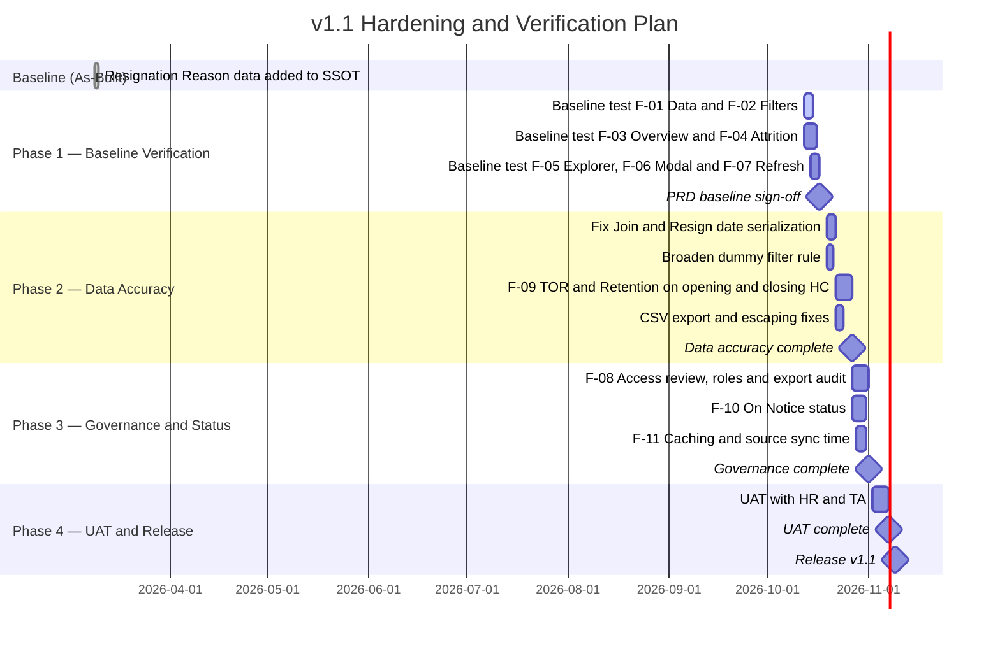

| Milestone | Target Date | Deliverable |
|-----------|-------------|-------------|
| M-01: PRD baseline sign-off | 2026-10-17 | PRD approved, F-01–F-07 baseline test results documented |
| M-02: Data accuracy | 2026-10-27 | Date fix, dummy rule, F-09, export fixes |
| M-03: Governance | 2026-11-01 | F-08 (access/roles/audit), F-10 (On Notice), F-11 (caching, sync time) |
| M-04: UAT | 2026-11-07 | UAT results with HR and TA, figure reconciliation vs SSOT |
| M-05: Release v1.1 | 2026-11-09 | Web App re-deployment and release notes |

---

## 15. Open Questions

Questions and **assumptions made** while drafting this PRD. All need confirmation before PRD sign-off.

| ID | Question / Assumption | Directed To | Deadline | Status |
|----|-----------------------|-------------|----------|--------|
| Q-01 | The Web App deployment settings (Execute as / Who has access) are not visible in the code. Assumption: access is limited to specific Google accounts. Is `?data=1` openly accessible? | HRIS Admin | 2026-10-14 | ⏳ Pending |
| Q-02 | The script time zone (`appsscript.json`) is unknown. Assumption: Asia/Jakarta, so R-01 applies. Please verify by comparing a 1st-of-month Resign Date in the sheet vs the dashboard | HRIS Admin | 2026-10-14 | ⏳ Pending |
| Q-03 | What is the company's official TOR and Retention formula? Assumption: follows ISO 30414 practice (leavers ÷ average opening–closing HC) | Head of HR | 2026-10-16 | ⏳ Pending |
| Q-04 | Should Active employees with a future Resign Date (snapshot: 1 record) count as "scheduled resign"? Assumption: not counted until the Last Day | HR Business Partner | 2026-10-16 | ⏳ Pending |
| Q-05 | What is the canonical rule for dummy/test records (Job Level "Dummy", Join Date 1900)? Assumption: all should be excluded | HRIS Admin | 2026-10-16 | ⏳ Pending |
| Q-06 | Personas (HR Ops, HRBP, TA, C-Level, Finance/Workforce Planning) are derived from code, not user research. Are they correct, and who are the actual users? | Product Owner | 2026-10-16 | ⏳ Pending |
| Q-07 | May individual names, religion, and marital status be visible to all dashboard users? Assumption: role-based access is needed | Head of HR / Legal | 2026-10-21 | ⏳ Pending |
| Q-08 | CSV export policy: who is entitled and is an audit trail needed? Assumption: yes | Head of HR | 2026-10-21 | ⏳ Pending |
| Q-09 | The Offboarding Form structure and the lookup key of `Mapping: MPP Role to CM` are not visible (only links in the Guideline). Behavior on sync failure is assumed to be "previous data persists" | HRIS Admin | 2026-10-21 | ⏳ Pending |
| Q-10 | The release date of the `resignDate` fix (v5 FIXED) and earlier version history are not recorded. Please provide the date and version for the Changelog | HRIS Admin | 2026-10-16 | ⏳ Pending |
| Q-11 | The uploaded HTML lost `$` characters in template literals; assumption: handlers work normally. Please provide the original source file | HRIS Admin | 2026-10-14 | ⏳ Pending |
| Q-12 | KPI targets, v1.1 schedule, and font/color configuration are PM proposals. Please approve; Author/Reviewer/Stakeholder remain `[TBD]` | Product Owner | 2026-10-16 | ⏳ Pending |
| Q-13 | Should Overview remain at 5 KPIs only, or are additional KPIs needed (e.g. Outsource vs Permanent ratio)? | C-Level / HR Head | 2026-10-21 | ⏳ Pending |
| Q-14 | Are Outsource employees (3,238 of 4,180 records, 139 active) included in headcount and TOR, or should they be separated? | Head of HR | 2026-10-16 | ⏳ Pending |
| Q-15 | Once On Notice is live: is On Notice counted as "Active"? Should Explorer support the Resigned Only filter? | Head of HR | 2026-10-21 | ⏳ Pending |

---

## Changelog

| Version | Date | Changes | Author |
|---------|------|---------|--------|
| 1.0.0 | 2026-10-12 | Initial document created by reverse-engineering Apps Script v5 FIXED, the `WebApp Demographic` frontend, and the SSOT | [TBD] |

### Product Release Notes (As-Built)

#### Apps Script v5 FIXED — Resign Date Parsing and Calculation Fix
> Release date is not recorded in the artifacts (Q-10).

| Aspect | Before | After |
|--------|--------|-------|
| Parsing | Column L (Resign Date) was not parsed in `parseRow()` | `parseDate(row[COL.resignDate])` is called; result stored as `YYYY-MM-DD`, or the raw text if it cannot be parsed |
| `getData()` payload | The `resignDate` field was **not** sent | `resignDate` added to every `employees[]` item (marked `✅ FIX`) |
| Date format | Varied | `parseDate()` handles `Date`, Sheets/Excel serial numbers (epoch 25569), `Date`-parseable strings, and `dd/mm/yyyy` / `dd-mm-yyyy` / `dd.mm.yyyy` |
| Status fallback | n/a | When column A is unrecognized, active status is decided by Full Name present and Resign Date empty |
| Impact on Attrition | Date-range resign filtering could not work because the frontend never received Resign Date, so Total Resign, TOR, and resign-per-period charts were inaccurate | The frontend filters resignations by **Resign Date** within the selected range; the modal and CSV export show the Resign Date column; Total Resign, TOR, Retention, per-period charts, and TOR per Position become computable |
| UI warning | None | The Attrition tab shows "⚠️ Filter periode ini menggunakan Resign Date" (this period filter uses Resign Date) |

> **Recommended follow-ups after this fix:** R-01 (date shift due to `toISOString`), R-02 (TOR formula), and R-11 (string date parsing order).

#### SSOT Improvement Notes (sheet `Improvement Note`)

| No | Improvement | Status | Completion Date |
|----|-------------|--------|-----------------|
| 1 | Update the Offboarding Form in the script for On Notice status to the new form | 🔵 In Progress | — |
| 2 | Add Resignation Reason data | ✅ Done | 2026-03-09 |
| 3 | Add Branch data to the Master Position sheet | ✅ Done | — |
| 4 | Dashboard of active employees per Org, Sub-Dept, Branch, CM | 🔵 In Progress | — |
| 5 | Update Guideline | 🔵 In Progress | — |
| 6 | Add SSOT 001 + Offboarding sheet | 🔵 In Progress | — |

---

*This is a living document — it will be continuously updated as the project evolves. All significant changes must be recorded in the Changelog.*
